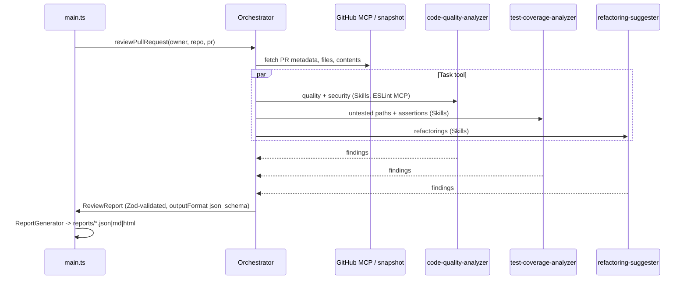

# Enterprise Multi-Agent Code Review Orchestrator

Automated pull request review built on the Claude Agent SDK. An orchestrator fetches a GitHub PR through MCP,
delegates analysis to three specialist subagents in parallel, validates their findings against Zod schemas and
writes JSON, Markdown and HTML reports. The application lives in [starter/](starter/); this directory is the
npm workspace root.

## Architecture



| Area | Implementation |
|------|----------------|
| Environment and auth | [main.ts](starter/src/main.ts) loads `starter/.env` and validates `ANTHROPIC_API_KEY` (or AWS Bedrock credentials), `ANTHROPIC_MODEL` and `PROJECT_ROOT` on startup. No secrets are stored in source. |
| MCP servers | [mcp.config.ts](starter/src/config/mcp.config.ts) exports stdio `npx` configs for `@modelcontextprotocol/server-github` (`GITHUB_PERSONAL_ACCESS_TOKEN` mapped from `GITHUB_TOKEN`) and `@eslint/mcp`. |
| Subagents | [src/agents/](starter/src/agents/): `AgentDefinition`s with `model: 'inherit'` and the `Skill` tool. Prompts are in [src/prompts/](starter/src/prompts/). |
| Claude Skills | [.claude/skills/](starter/.claude/skills/): `security-analysis`, `javascript-best-practices`, `typescript-patterns`, `test-analysis`, `refactoring-analysis`. Each prompt maps file types to the skills to load. |
| Orchestrator | [orchestrator.ts](starter/src/orchestrator.ts) calls `query()` with the `Task` tool, all three agents, MCP-derived `allowedTools` and `outputFormat` built with `zod-to-json-schema`. |
| Reliability | [error-handler.ts](starter/src/utils/error-handler.ts) (`withRetry` exponential backoff, `withTimeout`) and [rate-limiter.ts](starter/src/utils/rate-limiter.ts) (sliding-window requests/tokens + concurrency). |
| Reports | [report-generator.ts](starter/src/utils/report-generator.ts) writes `reports/<owner>_<repo>_<pr>.{json,md,html}`. |

## Setup

Requires Node.js 22.13 or newer. From this directory:

```bash
npm install
cp starter/.env.example starter/.env   # then edit it
```

`starter/.env` needs `ANTHROPIC_MODEL` and an absolute `PROJECT_ROOT` pointing to `starter/`. Set `ANTHROPIC_API_KEY`
(and `ANTHROPIC_BASE_URL` for Vocareum) there or in the environment. `GITHUB_TOKEN` is recommended; with the GitHub CLI
you can supply it without writing it to disk:

```powershell
$env:GITHUB_TOKEN = (gh auth token)   # PowerShell
```

```bash
export GITHUB_TOKEN="$(gh auth token)" # bash
```

Never commit `.env` or tokens. On Windows PowerShell use `npm.cmd` if the execution policy blocks `npm.ps1`.

## Commands

| Command | Purpose |
|---------|---------|
| `npm run build` | Compile TypeScript to `starter/dist/`. |
| `npm run lint` | Type-check without emitting. |
| `npm test` | Unit and integration tests (Vitest, mocked SDK, real MCP handshakes). |
| `npm start -- udacity cd14715-simple-todo-app --all` | Live review of PRs 1-3; writes the nine assignment reports. |
| `npm start -- <owner> <repo> <pr> [--output dir]` | Review a single PR. |
| `npm start -- <owner> <repo> <pr> --post-comment` | Also post the summary as a PR comment (needs a token that can comment). |
| `npm run eval` | Golden-dataset regression check over the generated reports. |

Live runs call the Claude API and incur charges (each SDK session is capped at USD 2). A single PR review can take
10-25 minutes on a busy provider; it is cancelled after 30 minutes unless `REVIEW_TIMEOUT_MINUTES` is set in `starter/.env`.
Independent PRs can be reviewed in parallel by starting one `npm start -- <owner> <repo> <pr>` process per PR.

The committed reports in [starter/reports/](starter/reports/) come from live runs of PRs 1-3; the
[results table](starter/README.md#submission-status) summarises them (3/3 golden cases pass).

## Stand-out features

- **Interactive CLI progress.** An [ora](https://github.com/sindresorhus/ora) spinner shows the current step (snapshot,
  each tool call, aggregation) with elapsed time and prints a progress bar line, e.g. `PR #2 [##-] 2/3 agents`, as each
  subagent starts and finishes. Without a TTY (piped output, CI) it prints plain lines plus a heartbeat every 30 seconds.
- **Agent execution traces.** The host records every `Task`, `Skill`, `Read`/`Grep`/`Glob` and MCP call from the SDK
  message stream, attributed to the agent that made it. Reports include a tool-usage table and a Mermaid sequence
  diagram. The trace is recorded by the host, not written by the model.
- **Automated PR commenting.** `--post-comment` posts a compact summary (score, counts, top recommendations, critical/high
  issues) through the GitHub MCP `add_issue_comment` tool. It is opt-in and never runs during tests.
- **Regression testing suite.** [golden-dataset.ts](starter/src/eval/golden-dataset.ts) lists the known defects of the
  assignment PRs. Examples: SQL injection at `src/todo.ts` lines 121/132/143 in PR 2, and untested payment functions in PR 3.
  PR 1 is a clean control. `npm run eval` and `tests/golden.test.ts` check that the agents keep detecting them.

## Project structure

```
starter/
├── .claude/skills/          Claude Skills used by the subagents
├── src/
│   ├── main.ts              CLI entry point
│   ├── orchestrator.ts      Multi-agent coordination, validation, aggregation
│   ├── agents/              Subagent definitions
│   ├── prompts/             Orchestrator and subagent prompts
│   ├── config/              MCP server configuration
│   ├── mcp/                 Read-only PR snapshot server, PR commenter
│   ├── eval/                Golden-dataset regression evaluation
│   ├── types/               Zod schemas (analysis results, ReviewReport)
│   └── utils/               Retry/timeout, rate limiter, logger, progress, trace, reports
├── tests/                   Vitest suites
└── reports/                 Generated review reports
```

See [starter/README.md](starter/README.md) for workflow details, limits and the submission status.
