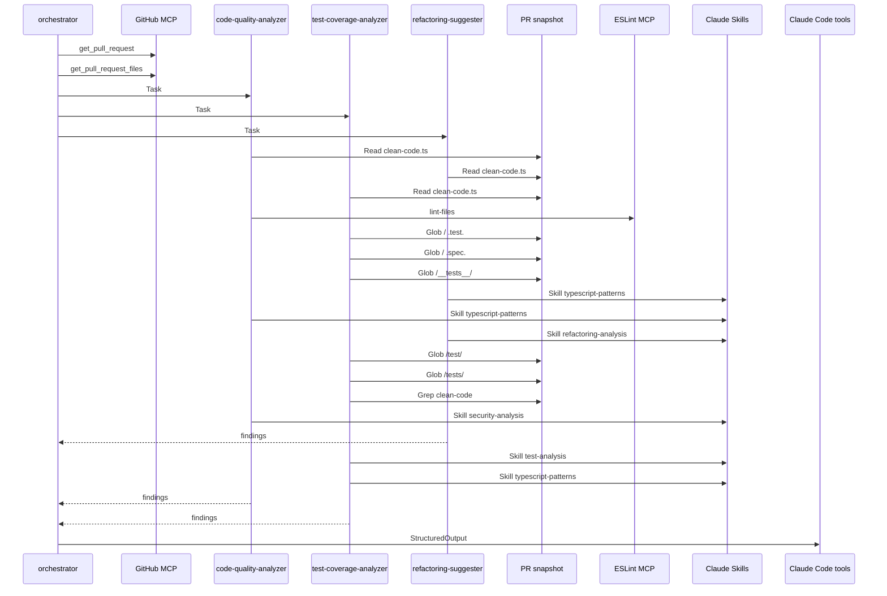

# DevFlow Code Review

udacity/cd14715-simple-todo-app | PR #1

## Summary

| Metric | Value |
| --- | --- |
| Overall quality score | 82/100 |
| Files reviewed | 1 |
| Critical issues | 0 |
| High-priority test gaps | 6 |
| Refactoring opportunities | 6 |

Coverage values are static estimates, not measured test coverage. A 100% value on a non-executable file is an N/A placeholder.

## Recommendations

1. **CRITICAL / Test Coverage**: Add comprehensive tests for security-critical functions sanitizeInput and createUser\. These functions handle XSS prevention and user input validation but have 0% test coverage\. Tests should verify XSS attack vectors are properly escaped, all validation error paths throw correct errors, and async error handling works correctly\.

Files: fixtures/clean-code\.ts

2. **HIGH / Security**: Replace Math\.random\(\) with crypto\.randomUUID\(\) for user ID generation\. Current implementation creates predictable IDs that could allow attackers to guess valid user IDs and potentially access unauthorized accounts\. This is a medium-severity security issue affecting user data integrity\.

Files: fixtures/clean-code\.ts

3. **HIGH / Security**: Apply input sanitization to email addresses before storage\. Currently only the name field is sanitized for XSS, but email is only lowercased\. If emails are displayed in HTML without proper escaping, this creates a stored XSS vulnerability\. Either sanitize emails or ensure all output contexts properly escape HTML\.

Files: fixtures/clean-code\.ts

4. **HIGH / Test Coverage**: Add tests for validation boundary functions isValidEmail, createUser input validation, and email format validation branches\. These are security boundaries that prevent invalid data entry but lack test verification for edge cases like whitespace-only inputs, null/undefined values, malformed emails, and error propagation\.

Files: fixtures/clean-code\.ts

5. **MEDIUM / Code Quality**: Improve email validation regex to prevent ReDoS attacks and handle RFC-compliant email formats\. Current regex is simplistic and vulnerable to regular expression denial of service\. Add email length validation \(RFC 5322 max is 254 characters\) and consider using a well-tested library like validator\.js\.

Files: fixtures/clean-code\.ts

6. **MEDIUM / Refactoring**: Extract validation logic into a separate validateCreateUserInput function to improve testability and reduce cyclomatic complexity\. This allows validation to be tested independently and reused across multiple operations that need to validate CreateUserInput\.

Files: fixtures/clean-code\.ts

7. **LOW / Best Practices**: Trim whitespace from input fields before validation\. Current validation checks for empty strings but doesn't trim first, allowing inputs like '   ' to pass validation\. Add \.trim\(\) calls before truthy checks to ensure data quality\.

Files: fixtures/clean-code\.ts

8. **LOW / Maintainability**: Remove or prefix unused variables 'query' and 'params' in saveUser function\. These create linting noise\. Either implement the database call, remove the variables, or prefix with underscore \(\_query, \_params\) to indicate intentional non-use in this fixture code\.

Files: fixtures/clean-code\.ts

## File Reviews

### fixtures/clean-code\.ts

Quality: 82/100 | Static coverage estimate: 0%

This TypeScript file demonstrates generally good code quality practices with proper typing, input validation, and parameterized database queries\. Skills applied: typescript-patterns and security-analysis\. MEDIUM severity issues found: \(1\) Non-cryptographic Math\.random\(\) used for user ID generation could lead to predictable IDs and potential unauthorized access; \(2\) Email input is not sanitized before storage, creating stored XSS risk if displayed without escaping\. LOW severity issues: basic email regex vulnerable to ReDoS, whitespace not trimmed in validation\. INFO level: unused variables from fixture code\. The code correctly uses parameterized queries preventing SQL injection, applies XSS sanitization to names, and has proper async/await patterns\. No critical or high severity issues detected\. Score reflects two medium security concerns around ID generation and incomplete input sanitization\.

#### Quality Issues

- **MEDIUM | security | Line 75**: Math\.random\(\) is not cryptographically secure and could lead to predictable user IDs\. An attacker might predict or brute-force user IDs, potentially accessing unauthorized accounts\.

  Fix: Use crypto\.randomUUID\(\) for secure ID generation: \`return crypto\.randomUUID\(\);\` or a library like uuid v4\.

- **MEDIUM | security | Line 60**: Email is not sanitized before storage, only lowercased\. If the email is later displayed in HTML without proper escaping, this could lead to stored XSS attacks via malicious email strings\.

  Fix: Apply sanitization to email as well: \`email: sanitizeInput\(input\.email\.toLowerCase\(\)\),\` or ensure all output contexts properly escape HTML\.

- **LOW | security | Line 26**: Email validation regex is simplistic and could be vulnerable to ReDoS \(Regular Expression Denial of Service\) attacks with crafted inputs\. The regex doesn't handle complex valid email formats or prevent malicious patterns\.

  Fix: Use a well-tested email validation library like validator\.js or a more robust regex pattern, and add length limits: \`if \(email\.length &gt; 254 \|\| \!emailRegex\.test\(email\)\) return false;\`

- **INFO | maintainability | Line 83**: Variable 'query' is assigned but never used\. This is commented-out fixture code but creates linting noise\.

  Fix: Either implement the actual database call, remove the unused variables, or prefix with underscore to indicate intentional non-use: \`const \_query = \.\.\.\`

- **INFO | maintainability | Line 84**: Variable 'params' is assigned but never used\. This is commented-out fixture code but creates linting noise\.

  Fix: Either implement the actual database call, remove the unused variables, or prefix with underscore to indicate intentional non-use: \`const \_params = \.\.\.\`

- **LOW | best-practice | Line 46**: Validation checks for empty strings but doesn't trim whitespace first\. An email like '  ' or name like '   ' would pass validation but be invalid\.

  Fix: Trim inputs before validation: \`if \(\!input\.email?\.trim\(\) \|\| \!input\.name?\.trim\(\)\)\` and use trimmed values throughout\.

#### Test Coverage

STATIC ESTIMATE: 0% - No test files exist for fixtures/clean-code\.ts\. This is an evaluation fixture file with 5 exported functions and 2 internal functions, all completely untested\. The estimate is based on: \(1\) Glob/Grep search found no \.test\.\*, \.spec\.\* files or \_\_tests\_\_/ directories in the snapshot, \(2\) no imports of 'clean-code' found in any test files, \(3\) manual inspection confirmed zero test coverage\. Critical gaps include: authentication boundary \(email validation\), XSS prevention \(sanitizeInput\), async error handling in createUser, input validation edge cases \(empty strings, null, undefined\), and database persistence verification\. High-priority missing tests: email validation with malformed inputs \(missing @, multiple @, no TLD\), XSS sanitization completeness \(event handlers, javascript: URLs\), createUser error paths \(missing fields, invalid email format, saveUser rejection\), and email normalization\. The file contains security-sensitive validation logic that should have comprehensive test coverage before production use\. Uncertainty: This is a static analysis based on file system search; actual measured coverage would require running a coverage tool like Istanbul/c8 against an executed test suite\.

Existing tests: None identified.

- **HIGH | isValidEmail \(line 25-28\)**: Email validation is a security boundary preventing invalid data entry\. The current regex is overly permissive and accepts invalid formats\. No tests verify rejection of malformed emails \(missing TLD, invalid characters, multiple @, etc\.\)

```text
describe('isValidEmail', () => {
  it('should accept valid standard emails', () => {
    expect(isValidEmail('user@example.com')).toBe(true);
    expect(isValidEmail('test.user+tag@subdomain.example.org')).toBe(true);
  });
  
  it('should reject emails without @', () => {
    expect(isValidEmail('notanemail')).toBe(false);
  });
  
  it('should reject emails without domain', () => {
    expect(isValidEmail('user@')).toBe(false);
    expect(isValidEmail('user@domain')).toBe(false);
  });
  
  it('should reject emails with multiple @', () => {
    expect(isValidEmail('user@@example.com')).toBe(false);
  });
  
  it('should reject empty string', () => {
    expect(isValidEmail('')).toBe(false);
  });
  
  it('should reject emails with spaces', () => {
    expect(isValidEmail('user @example.com')).toBe(false);
  });
});
```

- **CRITICAL | sanitizeInput \(line 33-39\)**: XSS prevention is a critical security control\. The function only escapes basic HTML characters but misses many XSS vectors: script event handlers \(onerror, onload\), javascript: URLs, data: URIs, and doesn't handle null/undefined\. No tests verify complete XSS protection or edge cases\.

```text
describe('sanitizeInput', () => {
  it('should escape basic HTML characters', () => {
    expect(sanitizeInput('<script>alert(1)</script>')).toBe('&lt;script&gt;alert(1)&lt;/script&gt;');
    expect(sanitizeInput('"quoted"')).toBe('&quot;quoted&quot;');
    expect(sanitizeInput("'single'")).toBe('&#039;single&#039;');
  });
  
  it('should handle mixed dangerous characters', () => {
    expect(sanitizeInput('')).toContain('&lt;img');
  });
  
  it('should handle empty string', () => {
    expect(sanitizeInput('')).toBe('');
  });
  
  it('should preserve safe text', () => {
    expect(sanitizeInput('John Doe')).toBe('John Doe');
  });
  
  it('should handle strings with only special chars', () => {
    expect(sanitizeInput('<>"\'')).toBe('&lt;&gt;&quot;&#039;');
  });
});
```

- **CRITICAL | createUser \(line 44-69\)**: createUser is the main entry point orchestrating validation, sanitization, and database persistence\. No tests verify: \(1\) successful user creation with valid input, \(2\) error throwing for missing email/name, \(3\) error throwing for invalid email, \(4\) proper sanitization application, \(5\) email normalization to lowercase, \(6\) async rejection handling if saveUser fails, \(7\) generated ID format\.

```text
describe('createUser', () => {
  beforeEach(() => {
    // Mock saveUser to prevent actual DB calls
    jest.spyOn(global, 'saveUser').mockResolvedValue();
  });
  
  it('should create user with valid input', async () => {
    const input = { email: 'Test@Example.COM', name: 'John Doe' };
    const user = await createUser(input);
    
    expect(user.email).toBe('test@example.com');
    expect(user.name).toBe('John Doe');
    expect(user.id).toMatch(/^user_\d+_[a-z0-9]+$/);
    expect(user.createdAt).toBeInstanceOf(Date);
  });
  
  it('should sanitize name with XSS attempt', async () => {
    const input = { email: 'user@example.com', name: '<script>alert(1)</script>' };
    const user = await createUser(input);
    
    expect(user.name).toBe('&lt;script&gt;alert(1)&lt;/script&gt;');
  });
  
  it('should throw error when email is missing', async () => {
    await expect(createUser({ email: '', name: 'John' }))
      .rejects.toThrow('Email and name are required');
  });
  
  it('should throw error when name is missing', async () => {
    await expect(createUser({ email: 'user@example.com', name: '' }))
      .rejects.toThrow('Email and name are required');
  });
  
  it('should throw error for invalid email format', async () => {
    await expect(createUser({ email: 'invalid-email', name: 'John' }))
      .rejects.toThrow('Invalid email format');
  });
  
  it('should call saveUser with created user', async () => {
    const input = { email: 'user@example.com', name: 'John' };
    await createUser(input);
    
    expect(saveUser).toHaveBeenCalledWith(expect.objectContaining({
      email: 'user@example.com',
      name: 'John'
    }));
  });
  
  it('should propagate saveUser rejection', async () => {
    jest.spyOn(global, 'saveUser').mockRejectedValue(new Error('DB error'));
    
    await expect(createUser({ email: 'user@example.com', name: 'John' }))
      .rejects.toThrow('DB error');
  });
});
```

- **HIGH | createUser email/name validation \(line 46-48\)**: The validation checks for falsy values but doesn't distinguish between missing fields vs empty strings\. Input like \{ email: '   ', name: 'John' \} could pass the truthy check if not trimmed\. No tests verify all invalid input combinations\.

```text
describe('createUser input validation edge cases', () => {
  it('should reject whitespace-only email', async () => {
    await expect(createUser({ email: '   ', name: 'John' }))
      .rejects.toThrow();
  });
  
  it('should reject whitespace-only name', async () => {
    await expect(createUser({ email: 'user@example.com', name: '   ' }))
      .rejects.toThrow();
  });
  
  it('should reject null values', async () => {
    await expect(createUser({ email: null as any, name: 'John' }))
      .rejects.toThrow('Email and name are required');
  });
  
  it('should reject undefined values', async () => {
    await expect(createUser({ email: undefined as any, name: 'John' }))
      .rejects.toThrow('Email and name are required');
  });
});
```

- **HIGH | createUser email validation \(line 50-52\)**: This branch throws an error for invalid email formats\. No tests verify the error message, error type, or that execution stops \(doesn't reach saveUser\)\. Critical for preventing invalid data persistence\.

```text
describe('createUser email format validation', () => {
  it('should throw specific error for invalid email', async () => {
    await expect(createUser({ email: 'not-an-email', name: 'John' }))
      .rejects.toThrow('Invalid email format');
  });
  
  it('should not call saveUser when email is invalid', async () => {
    const saveSpy = jest.spyOn(global, 'saveUser');
    
    try {
      await createUser({ email: 'invalid', name: 'John' });
    } catch (e) {
      // Expected
    }
    
    expect(saveSpy).not.toHaveBeenCalled();
  });
});
```

- **MEDIUM | generateId \(line 74-76\)**: ID generation uses Date\.now\(\) and Math\.random\(\) which have collision risks in high-concurrency scenarios or rapid successive calls\. No tests verify: \(1\) ID format consistency, \(2\) uniqueness across multiple calls, \(3\) that IDs are non-empty strings\. For production, should use crypto\.randomUUID\(\) or a proper ID library\.

```text
describe('generateId', () => {
  it('should generate ID with expected format', () => {
    const id = generateId();
    expect(id).toMatch(/^user_\d{13}_[a-z0-9]{7}$/);
  });
  
  it('should generate different IDs on successive calls', () => {
    const id1 = generateId();
    const id2 = generateId();
    expect(id1).not.toBe(id2);
  });
  
  it('should generate IDs starting with user_ prefix', () => {
    const id = generateId();
    expect(id).toMatch(/^user_/);
  });
  
  it('should generate IDs of reasonable length', () => {
    const id = generateId();
    expect(id.length).toBeGreaterThan(20);
    expect(id.length).toBeLessThan(50);
  });
});
```

- **MEDIUM | email\.toLowerCase\(\) \(line 60\)**: If input\.email is somehow not a string at runtime \(despite TypeScript types\), toLowerCase\(\) will throw\. Also, internationalized domain names \(IDN\) and email addresses with unicode characters need special handling\. No tests verify: \(1\) email case normalization, \(2\) handling of emails with unicode, \(3\) preservation of email address structure\.

```text
describe('createUser email normalization', () => {
  it('should convert email to lowercase', async () => {
    const user = await createUser({ 
      email: 'USER@EXAMPLE.COM', 
      name: 'John' 
    });
    expect(user.email).toBe('user@example.com');
  });
  
  it('should handle mixed case emails', async () => {
    const user = await createUser({ 
      email: 'UsEr@ExAmPlE.CoM', 
      name: 'John' 
    });
    expect(user.email).toBe('user@example.com');
  });
  
  it('should preserve email local part with plus addressing', async () => {
    const user = await createUser({ 
      email: 'user+TAG@example.com', 
      name: 'John' 
    });
    expect(user.email).toBe('user+tag@example.com');
  });
});
```

- **LOW | createdAt: new Date\(\) \(line 62\)**: The createdAt timestamp is set at object creation time but could differ from when saveUser completes, especially if saveUser is slow or retries\. Also, no tests verify that createdAt is a valid Date object or that it's approximately the current time\.

```text
describe('createUser timestamp handling', () => {
  it('should set createdAt to current time', async () => {
    const before = new Date();
    const user = await createUser({ 
      email: 'user@example.com', 
      name: 'John' 
    });
    const after = new Date();
    
    expect(user.createdAt.getTime()).toBeGreaterThanOrEqual(before.getTime());
    expect(user.createdAt.getTime()).toBeLessThanOrEqual(after.getTime());
  });
  
  it('should create valid Date object', async () => {
    const user = await createUser({ 
      email: 'user@example.com', 
      name: 'John' 
    });
    expect(user.createdAt).toBeInstanceOf(Date);
    expect(user.createdAt.toString()).not.toBe('Invalid Date');
  });
});
```

- **HIGH | saveUser \(line 81-87\)**: saveUser is async but has no actual implementation \(database query is commented out\)\. In tests, this needs to be mocked to verify: \(1\) it's called with correct parameters, \(2\) rejection handling propagates correctly, \(3\) the parameterized query pattern prevents SQL injection\. Without tests, changes to this function could break createUser silently\.

```text
describe('saveUser', () => {
  it('should be called with user object containing all fields', async () => {
    const mockSaveUser = jest.spyOn(global, 'saveUser').mockResolvedValue();
    
    await createUser({ email: 'user@example.com', name: 'John' });
    
    expect(mockSaveUser).toHaveBeenCalledWith(expect.objectContaining({
      id: expect.stringMatching(/^user_/),
      email: 'user@example.com',
      name: 'John',
      createdAt: expect.any(Date)
    }));
  });
  
  it('should handle database errors gracefully', async () => {
    jest.spyOn(global, 'saveUser').mockRejectedValue(new Error('Connection failed'));
    
    await expect(createUser({ email: 'user@example.com', name: 'John' }))
      .rejects.toThrow('Connection failed');
  });
  
  it('should use parameterized query structure', () => {
    // Verify the query string uses placeholders, not string concatenation
    const functionCode = saveUser.toString();
    expect(functionCode).toContain('$1, $2, $3, $4');
    expect(functionCode).not.toContain('${user.');
  });
});
```

#### Refactoring

The clean-code\.ts fixture is well-structured with good separation of concerns, but has six behavior-preserving improvement opportunities: \(1\) Extract validation logic \(medium impact\) to improve testability and reduce complexity, \(2\) Extract email normalization \(low impact\) for consistency, \(3\) Modernize email regex \(low impact\) for RFC compliance, \(4\) Add branded UserId type \(medium impact\) for compile-time safety, \(5\) Introduce Result type pattern \(high impact\) for explicit error handling, and \(6\) Simplify sanitization with lookup table \(low impact\) for performance and completeness\. All suggestions preserve existing behavior and require regression tests to verify error messages, validation rules, and data transformations remain identical\. The highest-value improvements are the Result type pattern for type-safe error handling and validation extraction for independent testability\.

#### extract-function: Lines 46-52 \(createUser validation logic\)

Impact: medium

Extract input validation logic into a dedicated validateCreateUserInput function\. This separates validation concerns from the creation workflow, making both easier to test and modify independently\.

Before:

```text
export async function createUser(input: CreateUserInput): Promise<User> {
  // Validate input
  if (!input.email || !input.name) {
    throw new Error('Email and name are required');
  }

  if (!isValidEmail(input.email)) {
    throw new Error('Invalid email format');
  }

  // Sanitize input
  const sanitizedName = sanitizeInput(input.name);
```

After:

```text
function validateCreateUserInput(input: CreateUserInput): void {
  if (!input.email || !input.name) {
    throw new Error('Email and name are required');
  }

  if (!isValidEmail(input.email)) {
    throw new Error('Invalid email format');
  }
}

export async function createUser(input: CreateUserInput): Promise<User> {
  validateCreateUserInput(input);

  // Sanitize input
  const sanitizedName = sanitizeInput(input.name);
```

Benefits: Makes validation logic testable in isolation\. Reduces cyclomatic complexity of createUser from 3 to 1\. Allows reuse of validation logic if other operations need to validate CreateUserInput\. Regression test: Verify all validation errors still throw with identical messages for empty email, empty name, and invalid email format\.

#### extract-function: Line 60 \(email normalization in createUser\)

Impact: low

Extract email normalization \(toLowerCase\) into a named function\. This makes the normalization explicit and testable, especially important for email handling consistency across the system\.

Before:

```text
  const user: User = {
    id: generateId(),
    email: input.email.toLowerCase(),
    name: sanitizedName,
    createdAt: new Date()
  };
```

After:

```text
function normalizeEmail(email: string): string {
  return email.toLowerCase().trim();
}

  const user: User = {
    id: generateId(),
    email: normalizeEmail(input.email),
    name: sanitizedName,
    createdAt: new Date()
  };
```

Benefits: Creates a single source of truth for email normalization\. Enables adding \.trim\(\) to handle whitespace consistently\. Makes the operation testable and discoverable\. If email normalization logic needs enhancement \(e\.g\., removing \+ aliases\), there's one place to change\. Regression test: Verify 'Test@Example\.COM' becomes 'test@example\.com' and whitespace is trimmed\.

#### modernize: Lines 25-28 \(email validation regex\)

Impact: low

Modernize email validation to use a more robust regex or reference a well-tested library pattern\. The current regex is basic and may allow invalid emails\. Add const assertion for immutability\.

Before:

```text
export function isValidEmail(email: string): boolean {
  const emailRegex = /^[^\s@]+@[^\s@]+\.[^\s@]+$/;
  return emailRegex.test(email);
}
```

After:

```text
const EMAIL_REGEX = /^[a-zA-Z0-9._%+-]+@[a-zA-Z0-9.-]+\.[a-zA-Z]{2,}$/ as const;

export function isValidEmail(email: string): boolean {
  if (!email || email.length > 254) {
    return false;
  }
  return EMAIL_REGEX.test(email);
}
```

Benefits: More accurate email validation following RFC 5322 character classes\. Adds length check \(RFC max is 254\)\. Using const at module level prevents regex recompilation on each call\. 'as const' ensures immutability\. Regression test: Verify existing valid emails pass, invalid emails fail, and edge cases like empty string and 255\+ character emails are rejected\.

#### pattern-improvement: Lines 74-76 \(ID generation\)

Impact: medium

Introduce a branded type for UserId to prevent mixing user IDs with other strings\. This adds compile-time safety to ensure IDs are only created through the proper generation function\.

Before:

```text
export interface User {
  id: string;
  email: string;
  name: string;
  createdAt: Date;
}

function generateId(): string {
  return `user_${Date.now()}_${Math.random().toString(36).slice(2, 9)}`;
}
```

After:

```text
export type UserId = string & { readonly __brand: 'UserId' };

export interface User {
  id: UserId;
  email: string;
  name: string;
  createdAt: Date;
}

function generateId(): UserId {
  return `user_${Date.now()}_${Math.random().toString(36).slice(2, 9)}` as UserId;
}

// Helper for external IDs from database
export function toUserId(id: string): UserId {
  return id as UserId;
}
```

Benefits: Prevents accidental assignment of arbitrary strings to user\.id\. Provides type-level documentation that this field has specific semantics\. Makes it impossible to pass a raw string where a UserId is expected without explicit conversion\. No runtime overhead - purely compile-time safety\. Regression test: Verify existing functionality unchanged; add compile-time test that string literals cannot be assigned to UserId without conversion\.

#### pattern-improvement: Lines 44-69 \(createUser return type\)

Impact: high

Replace throwing errors with a Result type pattern \(discriminated union\) to make error handling explicit and type-safe\. This forces callers to handle all error cases at compile time\.

Before:

```text
export async function createUser(input: CreateUserInput): Promise<User> {
  // Validate input
  if (!input.email || !input.name) {
    throw new Error('Email and name are required');
  }

  if (!isValidEmail(input.email)) {
    throw new Error('Invalid email format');
  }
  // ... rest of function
  return user;
}
```

After:

```text
type ValidationError = 
  | { type: 'MISSING_FIELDS'; message: string }
  | { type: 'INVALID_EMAIL'; message: string };

type CreateUserResult = 
  | { success: true; user: User }
  | { success: false; error: ValidationError };

export async function createUser(input: CreateUserInput): Promise<CreateUserResult> {
  // Validate input
  if (!input.email || !input.name) {
    return { 
      success: false, 
      error: { type: 'MISSING_FIELDS', message: 'Email and name are required' }
    };
  }

  if (!isValidEmail(input.email)) {
    return { 
      success: false, 
      error: { type: 'INVALID_EMAIL', message: 'Invalid email format' }
    };
  }
  
  // ... rest of function
  return { success: true, user };
}
```

Benefits: Eliminates hidden control flow from thrown exceptions\. Makes all error cases explicit in the type system - callers must check success before accessing user\. Enables exhaustive error handling with discriminated unions\. Allows different handling per error type \(e\.g\., logging, user messaging\)\. Reduces unexpected crashes from unhandled errors\. Regression test: Update all callers to handle Result type; verify validation errors return expected error types; verify successful creation returns success: true with valid user\.

#### simplify: Lines 33-39 \(sanitizeInput implementation\)

Impact: low

Simplify sanitizeInput by using a lookup table or DOMParser-based approach\. Current chaining is verbose and could miss additional XSS vectors\. Consider using a well-tested library or built-in API\.

Before:

```text
export function sanitizeInput(input: string): string {
  return input
    .replace(/</g, '&lt;')
    .replace(/>/g, '&gt;')
    .replace(/"/g, '&quot;')
    .replace(/'/g, '&#039;');
}
```

After:

```text
const HTML_ESCAPE_MAP: Record<string, string> = {
  '<': '&lt;',
  '>': '&gt;',
  '"': '&quot;',
  "'": '&#039;',
  '&': '&amp;'
} as const;

export function sanitizeInput(input: string): string {
  return input.replace(/[<>"'&]/g, (char) => HTML_ESCAPE_MAP[char] || char);
}
```

Benefits: Single regex pass instead of 4-5 separate passes improves performance\. Adds missing '&amp;' escape which should be escaped first to prevent double-escaping issues\. Lookup table is more maintainable - adding new escapes is clear\. Makes the complete set of escaped characters explicit\. Regression test: Verify all existing escapes work identically; verify '&amp;' is now escaped; verify performance with 1000\+ character strings\.

## Agent Execution Trace

Recorded by the orchestrator from the Claude Agent SDK message stream (not written by the model). Each arrow is a tool call; dashed arrows are subagents returning findings.

| Actor | Tool calls |
| --- | --- |
| orchestrator | get\_pull\_request x1, get\_pull\_request\_files x1, Task x3, StructuredOutput x1 |
| code-quality-analyzer | Read x1, lint-files x1, Skill x2 |
| refactoring-suggester | Read x1, Skill x2 |
| test-coverage-analyzer | Read x1, Glob x5, Grep x1, Skill x2 |



---

Analyzed at 2026-11-06T13:38:29.749Z | Duration: 727604 ms

Agents: code-quality-analyzer (1\.0\.0), test-coverage-analyzer (1\.0\.0), refactoring-suggester (1\.0\.0)
