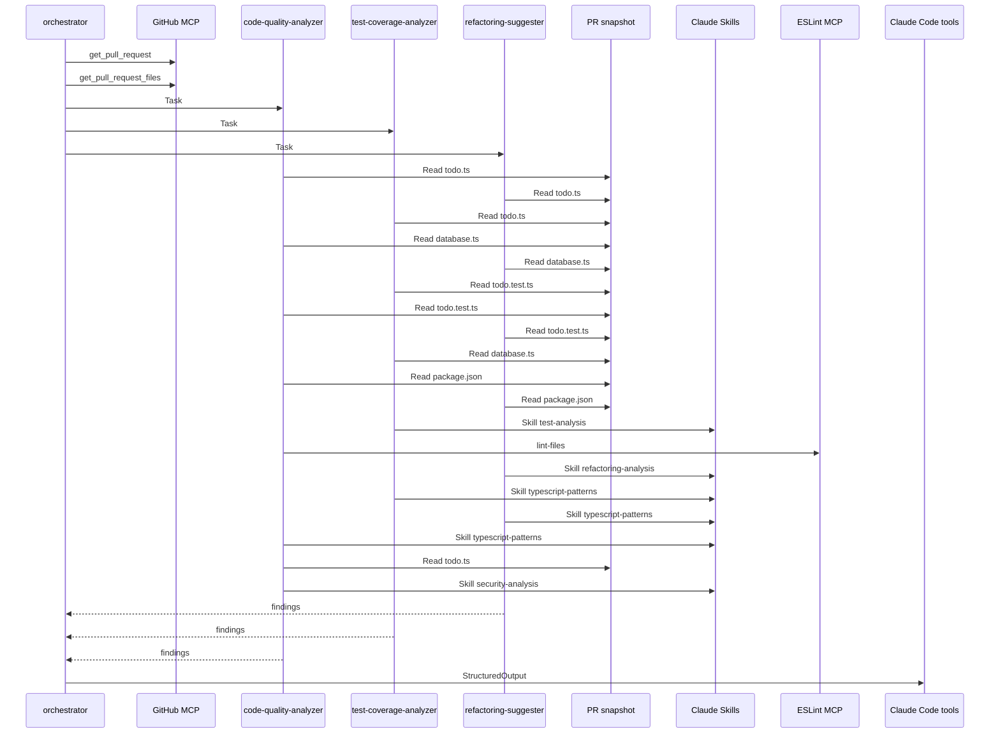

# DevFlow Code Review

udacity/cd14715-simple-todo-app | PR #2

## Summary

| Metric | Value |
| --- | --- |
| Overall quality score | 0/100 |
| Files reviewed | 1 |
| Critical issues | 3 |
| High-priority test gaps | 7 |
| Refactoring opportunities | 6 |

Coverage values are static estimates, not measured test coverage. A 100% value on a non-executable file is an N/A placeholder.

## Recommendations

1. **CRITICAL / Security - SQL Injection**: Three critical SQL injection vulnerabilities must be fixed immediately before deployment\. All three new functions \(searchTodos, searchTodosByStatus, getTodosByUser\) use string concatenation or template literal interpolation to build SQL queries with user-controlled input, allowing attackers to execute arbitrary SQL commands, bypass authorization, exfiltrate data, or destroy database tables\. Replace with parameterized queries using positional parameters \($1, $2, etc\.\) as demonstrated in existing secure functions\.

Files: src/todo\.ts

2. **CRITICAL / Test Coverage - Security Testing**: No security tests exist for the three new search functions\. Add comprehensive test suites that verify SQL injection prevention by attempting malicious inputs like "' OR '1'='1", "'; DROP TABLE todos; --", and other injection patterns\. Tests should verify that malicious inputs are safely handled and do not result in unauthorized data access or destructive operations\.

Files: src/todo\.ts

3. **HIGH / Type Safety**: The searchTodosByStatus function has a type mismatch where the 'completed' parameter is typed as string but should be boolean to match the database schema and prevent injection\. Change the parameter type to boolean and update the implementation to use parameterized queries\. This will provide compile-time type safety and prevent invalid values from being passed\.

Files: src/todo\.ts

4. **HIGH / Test Coverage - Functional Testing**: The three new functions have zero test coverage\. Add unit tests for normal operation \(successful searches, empty results\), edge cases \(empty strings, special characters, very long inputs, Unicode\), error handling \(database failures, query timeouts\), and type validation \(verify returned objects match Todo interface\)\. Prioritize tests for searchTodos, searchTodosByStatus, and getTodosByUser\.

Files: src/todo\.ts

5. **MEDIUM / Code Quality - Type Safety**: Five instances of unsafe type casts \(lines 82, 96, 123, 134, 145\) where database results are cast to Todo or Todo\[\] without runtime validation\. If the database schema changes or returns unexpected data, this creates risk of type confusion and runtime errors\. Implement runtime validation using type guards before casting, or use a schema validation library like zod to ensure data integrity\.

Files: src/todo\.ts

6. **MEDIUM / Security - Weak Cryptography**: The generateId function uses Math\.random\(\) which is not cryptographically secure\. An attacker could potentially predict IDs and attempt unauthorized access to todos\. Replace with cryptographically secure random generation using crypto\.randomBytes\(\) or use a UUID library to generate unpredictable identifiers\.

Files: src/todo\.ts

7. **LOW / Code Quality - Input Validation**: The new search functions lack input validation for edge cases\. Add validation for empty strings, length limits \(prevent performance issues from overly long keywords\), and format validation \(for userId\)\. This improves robustness and provides better error messages to API consumers\.

Files: src/todo\.ts

## File Reviews

### src/todo\.ts

Quality: 0/100 | Static coverage estimate: 15%

Analysis of src/todo\.ts \(TypeScript file, 154 lines\) found 14 issues across security, bug-risk, and maintainability categories\. CRITICAL FINDINGS: Three SQL injection vulnerabilities in newly added functions \(lines 121, 132, 143\) where user-controlled parameters are directly interpolated into SQL queries via template literals or string concatenation\. These are exploitable for data exfiltration, unauthorized access, and destructive operations\. The searchTodos function \(line 121\) allows arbitrary LIKE clause bypass\. The searchTodosByStatus function \(line 132\) has both SQL injection and a type mismatch \(string instead of boolean\)\. The getTodosByUser function \(line 143\) enables cross-user data access and authorization bypass\. HIGH: Type mismatch on line 130 enables injection\. MEDIUM: Five unsafe type casts \(lines 82, 96, 123, 134, 145\) where database results are cast to Todo/Todo\[\] without runtime validation, risking type confusion\. Weak ID generation \(line 152\) uses non-cryptographic Math\.random\(\)\. Misleading sanitization function \(line 40\) provides false security confidence\. LOW/INFO: Inconsistent null handling \(line 57\) and missing input validation \(lines 119, 141\)\. The existing safe functions \(lines 51-113\) correctly use parameterized queries, but the three new functions \(lines 115-146\) introduce critical vulnerabilities that must be fixed before deployment\. Overall score: 0 \(critical vulnerabilities present\)\.

#### Quality Issues

- **CRITICAL | security | Line 121**: SQL injection vulnerability: User-controlled 'keyword' parameter is directly interpolated into SQL query using template literal\. An attacker can inject malicious SQL like "' OR '1'='1" to bypass the LIKE clause and return all todos, or "'; DROP TABLE todos; --" to execute destructive commands\.

  Fix: Replace template literal with parameterized query: \`const query = 'SELECT \* FROM todos WHERE title LIKE $1 OR description LIKE $2'; const rows = await db\.query\(query, \[\`%$\{keyword\}%\`, \`%$\{keyword\}%\`\]\);\`

- **CRITICAL | security | Line 132**: SQL injection vulnerability: User-controlled 'completed' parameter is concatenated directly into SQL query without parameterization\. An attacker can inject "1 OR 1=1" to return all todos or "1; DELETE FROM todos; --" to execute arbitrary SQL commands\.

  Fix: Use parameterized query and fix type: Change parameter type to \`completed: boolean\` and use: \`const sql = 'SELECT \* FROM todos WHERE completed = $1'; const rows = await db\.query\(sql, \[completed\]\);\`

- **CRITICAL | security | Line 143**: SQL injection vulnerability with authorization bypass risk: User-controlled 'userId' parameter is interpolated into SQL query using template literal\. An attacker can inject "' OR '1'='1' --" to access todos from all users, bypassing user isolation and accessing sensitive data across user boundaries\.

  Fix: Replace template literal with parameterized query: \`const query = 'SELECT t\.\* FROM todos t JOIN user\_todos ut ON t\.id = ut\.todo\_id WHERE ut\.user\_id = $1'; const rows = await db\.query\(query, \[userId\]\);\`

- **HIGH | bug-risk | Line 130**: Type mismatch: Parameter 'completed' is typed as 'string' but represents a boolean database column\. This incorrect typing enables SQL injection and creates a confusing API that invites misuse\.

  Fix: Change function signature to: \`export async function searchTodosByStatus\(completed: boolean\): Promise&lt;Todo\[\]&gt;\` and use parameterized query as described in the line 132 issue\.

- **MEDIUM | bug-risk | Line 82**: Unsafe type cast: Database rows are cast to 'Todo\[\]' with 'as' without runtime validation\. If the database schema changes or returns unexpected data, this will cause runtime errors or type confusion bugs\.

  Fix: Add runtime validation using a type guard or schema validator \(e\.g\., zod\): \`function isTodo\(obj: any\): obj is Todo \{ return typeof obj\.id === 'string' &amp;&amp; typeof obj\.title === 'string' &amp;&amp; typeof obj\.description === 'string' &amp;&amp; typeof obj\.completed === 'boolean' &amp;&amp; obj\.createdAt instanceof Date; \}\` then validate: \`return rows\.filter\(isTodo\);\`

- **MEDIUM | bug-risk | Line 96**: Unsafe type cast: Database row is cast to 'Todo' with 'as' without runtime validation\. While array bounds are checked on line 92, the cast assumes the database returns data matching the Todo interface without verification\.

  Fix: Add runtime validation: Create a type guard \`isTodo\` and use: \`const row = rows\[0\]; if \(\!isTodo\(row\)\) \{ throw new Error\('Invalid todo data from database'\); \} return row;\`

- **MEDIUM | bug-risk | Line 123**: Unsafe type cast: Database rows are cast to 'Todo\[\]' without runtime validation\. Combined with the SQL injection vulnerability on line 121, malformed data could bypass type safety\.

  Fix: Add runtime validation with type guard as described in line 82 issue, after fixing the SQL injection vulnerability\.

- **MEDIUM | bug-risk | Line 134**: Unsafe type cast: Database rows are cast to 'Todo\[\]' without runtime validation\. Combined with the SQL injection vulnerability on line 132, this creates additional risk of type confusion\.

  Fix: Add runtime validation with type guard as described in line 82 issue, after fixing the SQL injection vulnerability\.

- **MEDIUM | bug-risk | Line 145**: Unsafe type cast: Database rows are cast to 'Todo\[\]' without runtime validation\. Combined with the SQL injection vulnerability on line 143, this creates risk of processing malicious or malformed data\.

  Fix: Add runtime validation with type guard as described in line 82 issue, after fixing the SQL injection vulnerability\.

- **MEDIUM | security | Line 152**: Weak ID generation: Uses Math\.random\(\) which is not cryptographically secure\. An attacker could potentially predict IDs and attempt to access unauthorized todos, especially if there's no robust authorization layer checking ownership\.

  Fix: Use cryptographically secure random generation: \`import \{ randomBytes \} from 'crypto'; return \`todo\_$\{Date\.now\(\)\}\_$\{randomBytes\(6\)\.toString\('hex'\)\}\`;\` or use a UUID library: \`import \{ v4 as uuidv4 \} from 'uuid'; return uuidv4\(\);\`

- **MEDIUM | security | Line 40**: Misleading sanitization: The sanitizeInput function only escapes HTML entities and provides NO protection against SQL injection\. The comment on line 38 says 'prevent XSS' but it's used in createTodo \(lines 56-57\) which then uses parameterized queries, making the HTML sanitization potentially unnecessary and giving false security confidence\.

  Fix: Either remove HTML sanitization and rely solely on parameterized queries for SQL safety \(and proper output encoding in the UI layer for XSS\), or clearly document that this is only for output encoding: \`/\*\* Encodes HTML entities for safe display in HTML context\. Does NOT protect against SQL injection\. \*/\`

- **LOW | bug-risk | Line 57**: Inconsistent null handling: If input\.description is undefined, it defaults to empty string here, but the validation on line 31 checks input\.description truthiness\. This creates inconsistent behavior where undefined passes validation but gets treated as empty string\.

  Fix: Make description optional in the interface and handle consistently: \`description?: string;\` in CreateTodoInput, and in validation: \`if \(input\.description \!== undefined &amp;&amp; input\.description\.length &gt; 1000\)\`, and in sanitization: \`const sanitizedDescription = input\.description ? sanitizeInput\(input\.description\) : '';\`

- **INFO | maintainability | Line 119**: Missing input validation: The searchTodos function does not validate or sanitize the keyword parameter before use\. While the primary issue is SQL injection, there should also be validation for length limits to prevent performance issues from overly broad searches\.

  Fix: Add validation: \`if \(\!keyword \|\| keyword\.trim\(\)\.length === 0\) \{ throw new Error\('Search keyword cannot be empty'\); \} if \(keyword\.length &gt; 100\) \{ throw new Error\('Search keyword too long'\); \}\`

- **INFO | maintainability | Line 141**: Missing input validation: The getTodosByUser function does not validate the userId parameter format\. While the primary issue is SQL injection, validation would improve robustness\.

  Fix: Add validation: \`if \(\!userId \|\| typeof userId \!== 'string' \|\| userId\.trim\(\)\.length === 0\) \{ throw new Error\('Invalid user ID'\); \}\`

#### Test Coverage

Static coverage estimate: ~15% of todo\.ts is tested\. Test file exists at src/todo\.test\.ts but only tests 2 of 13 exported functions \(validateTodoInput and sanitizeInput\)\. The three new functions added in PR \#2 have ZERO test coverage: searchTodos \(lines 119-124\), searchTodosByStatus \(lines 130-135\), and getTodosByUser \(lines 141-146\)\. All three contain CRITICAL SQL injection vulnerabilities from direct string concatenation/interpolation of user input into SQL queries without parameterized queries\. No tests verify secure behavior, attempt injection attacks, validate input sanitization, test empty results, handle errors, or check type safety of returned data\. Existing functions getAllTodos, getTodoById, updateTodoStatus, and deleteTodo are also untested\. Critical gaps: \(1\) No security tests for SQL injection in new search functions, \(2\) No validation of database query parameterization, \(3\) No edge case testing for empty strings, special characters, or invalid types, \(4\) No error handling tests for database failures, \(5\) No type validation tests for unsafe 'as Todo\[\]' casts\.

Existing tests: src/todo\.test\.ts

- **CRITICAL | searchTodos \(lines 119-124\)**: SQL injection vulnerability through direct string interpolation of keyword parameter in LIKE clauses\. Attacker can inject arbitrary SQL including UNION queries, data exfiltration, or DROP commands\. No tests verify secure behavior or attempt injection attacks\.

```text
describe('searchTodos', () => {
  it('should find todos matching keyword in title', async () => {
    await createTodo({ title: 'Buy milk', description: 'From store' });
    const results = await searchTodos('milk');
    expect(results).toHaveLength(1);
    expect(results[0].title).toContain('milk');
  });
  
  it('should prevent SQL injection via keyword parameter', async () => {
    const maliciousKeyword = "'; DROP TABLE todos; --";
    const results = await searchTodos(maliciousKeyword);
    // Should return empty or error, not execute injection
    expect(results).toBeDefined();
    // Verify todos table still exists by querying it
    const allTodos = await getAllTodos();
    expect(allTodos).toBeDefined();
  });
  
  it('should handle special SQL characters safely', async () => {
    const results = await searchTodos("%' OR '1'='1");
    expect(results).toBeDefined();
  });
  
  it('should return empty array when no matches found', async () => {
    const results = await searchTodos('nonexistent');
    expect(results).toEqual([]);
  });
  
  it('should handle empty string keyword', async () => {
    const results = await searchTodos('');
    expect(results).toBeDefined();
    expect(Array.isArray(results)).toBe(true);
  });
});
```

- **CRITICAL | searchTodosByStatus \(lines 130-135\)**: SQL injection vulnerability through string concatenation of completed parameter without validation\. Parameter is typed as string but used as boolean in SQL WHERE clause, allowing arbitrary SQL injection\. Attacker can append malicious SQL via the completed parameter\. No input validation, no parameterized query, no tests\.

```text
describe('searchTodosByStatus', () => {
  it('should return completed todos when status is true', async () => {
    const todo1 = await createTodo({ title: 'Task 1', description: 'Done' });
    await updateTodoStatus(todo1.id, true);
    const results = await searchTodosByStatus('true');
    expect(results.every(t => t.completed === true)).toBe(true);
  });
  
  it('should return incomplete todos when status is false', async () => {
    await createTodo({ title: 'Task 2', description: 'Pending' });
    const results = await searchTodosByStatus('false');
    expect(results.every(t => t.completed === false)).toBe(true);
  });
  
  it('should prevent SQL injection via completed parameter', async () => {
    const maliciousInput = "true OR 1=1; DROP TABLE todos; --";
    await expect(async () => {
      await searchTodosByStatus(maliciousInput);
    }).not.toThrow();
    // Verify table still exists
    const allTodos = await getAllTodos();
    expect(allTodos).toBeDefined();
  });
  
  it('should handle invalid boolean strings safely', async () => {
    const results = await searchTodosByStatus('invalid');
    expect(results).toBeDefined();
  });
  
  it('should reject or sanitize single quote injection attempts', async () => {
    const results = await searchTodosByStatus("' OR '1'='1");
    expect(results).toBeDefined();
  });
});
```

- **CRITICAL | getTodosByUser \(lines 141-146\)**: SQL injection vulnerability with template literal interpolation of userId parameter in JOIN query\. No input sanitization or parameterized query\. Attacker can break out of quoted context and inject arbitrary SQL including subqueries or data exfiltration from user\_todos table\. Authorization bypass risk if attacker manipulates query logic\. No tests exist\.

```text
describe('getTodosByUser', () => {
  it('should return todos for specific user', async () => {
    const userId = 'user_123';
    const results = await getTodosByUser(userId);
    expect(Array.isArray(results)).toBe(true);
  });
  
  it('should return empty array when user has no todos', async () => {
    const results = await getTodosByUser('user_nonexistent');
    expect(results).toEqual([]);
  });
  
  it('should prevent SQL injection via userId parameter', async () => {
    const maliciousUserId = "' OR '1'='1'; DROP TABLE user_todos; --";
    await expect(async () => {
      await getTodosByUser(maliciousUserId);
    }).not.toThrow();
    // Verify no unauthorized data access
  });
  
  it('should prevent authorization bypass via SQL injection', async () => {
    // Attempt to retrieve all users todos via injection
    const bypassAttempt = "anything' OR '1'='1";
    const results = await getTodosByUser(bypassAttempt);
    // Should not return todos from multiple users
    expect(results).toBeDefined();
  });
  
  it('should handle special characters in userId', async () => {
    const results = await getTodosByUser("user'test");
    expect(results).toBeDefined();
  });
  
  it('should handle empty userId string', async () => {
    const results = await getTodosByUser('');
    expect(results).toBeDefined();
    expect(Array.isArray(results)).toBe(true);
  });
});
```

- **HIGH | searchTodos - keyword parameter \(line 119\)**: No validation on keyword length or content\. Very long keywords or keywords with many special characters could cause performance issues or database timeouts\. Empty string returns all todos \(potential information disclosure\)\. No tests for boundary conditions\.

```text
it('should handle very long keyword strings without timeout', async () => {
  const longKeyword = 'a'.repeat(10000);
  await expect(searchTodos(longKeyword)).resolves.toBeDefined();
}, 5000);

it('should handle Unicode and special characters', async () => {
  const unicodeKeyword = '测试🔍';
  const results = await searchTodos(unicodeKeyword);
  expect(Array.isArray(results)).toBe(true);
});
```

- **HIGH | searchTodosByStatus - type mismatch \(line 130\)**: Parameter typed as string but SQL expects boolean\. No validation or conversion logic\. Passing non-boolean strings \('yes', '1', null, undefined, object\) could cause SQL errors or unexpected behavior\. Type system provides false safety\. No tests for type coercion or invalid inputs\.

```text
it('should handle string boolean values correctly', async () => {
  const tests = ['true', 'false', 'TRUE', 'FALSE', '1', '0'];
  for (const val of tests) {
    const results = await searchTodosByStatus(val);
    expect(Array.isArray(results)).toBe(true);
  }
});

it('should handle null or undefined gracefully', async () => {
  await expect(searchTodosByStatus(null as any)).rejects.toThrow();
  await expect(searchTodosByStatus(undefined as any)).rejects.toThrow();
});
```

- **HIGH | All three new functions - return type cast \(lines 123, 134, 145\)**: Unsafe 'as Todo\[\]' cast without runtime validation of database results\. If database schema changes or returns unexpected data \(null fields, wrong types\), application will have type safety illusion but runtime failures\. No tests verify returned objects match Todo interface shape\.

```text
it('should return objects matching Todo interface', async () => {
  const results = await searchTodos('test');
  results.forEach(todo => {
    expect(todo).toHaveProperty('id');
    expect(todo).toHaveProperty('title');
    expect(todo).toHaveProperty('description');
    expect(todo).toHaveProperty('completed');
    expect(todo).toHaveProperty('createdAt');
    expect(typeof todo.id).toBe('string');
    expect(typeof todo.title).toBe('string');
    expect(typeof todo.completed).toBe('boolean');
    expect(todo.createdAt).toBeInstanceOf(Date);
  });
});
```

- **MEDIUM | searchTodos - empty result set \(line 122\)**: When no todos match the search keyword, function returns empty array\. No test verifies this code path\. Important for UI handling of 'no results' state and ensures no null/undefined returned instead of empty array\.

```text
it('should return empty array when no todos match keyword', async () => {
  await createTodo({ title: 'Task A', description: 'Description A' });
  const results = await searchTodos('zzz_nonexistent_zzz');
  expect(results).toEqual([]);
  expect(results.length).toBe(0);
});
```

- **MEDIUM | searchTodosByStatus - empty result set \(line 133\)**: When no todos have the specified status, function returns empty array\. No test verifies this branch\. Edge case: new database with no todos at all should return empty array not error\.

```text
it('should return empty array when no todos have specified status', async () => {
  // Create only incomplete todos
  await createTodo({ title: 'Incomplete task', description: 'Not done' });
  const results = await searchTodosByStatus('true');
  expect(results).toEqual([]);
});

it('should handle search in empty database', async () => {
  // Assuming fresh database
  const results = await searchTodosByStatus('false');
  expect(Array.isArray(results)).toBe(true);
});
```

- **MEDIUM | getTodosByUser - empty result set \(line 144\)**: When user has no todos or userId not found in user\_todos table, returns empty array\. No test for this branch\. Critical for new users or after bulk deletion scenarios\. JOIN could return empty set differently than WHERE with no matches\.

```text
it('should return empty array when user exists but has no todos', async () => {
  const results = await getTodosByUser('user_new_no_todos');
  expect(results).toEqual([]);
  expect(results.length).toBe(0);
});
```

- **HIGH | All three new functions - database error handling \(lines 122, 133, 144\)**: No error handling or try-catch blocks\. If database connection fails, query times out, or SQL syntax error occurs \(from injection or schema mismatch\), functions will throw unhandled promise rejection\. No tests verify error propagation or graceful degradation\.

```text
it('should propagate database errors appropriately', async () => {
  // Mock db.query to throw error
  jest.spyOn(db, 'query').mockRejectedValueOnce(new Error('Database connection failed'));
  await expect(searchTodos('test')).rejects.toThrow('Database connection failed');
});

it('should handle query timeout errors', async () => {
  jest.spyOn(db, 'query').mockRejectedValueOnce(new Error('Query timeout'));
  await expect(searchTodosByStatus('true')).rejects.toThrow();
});
```

- **MEDIUM | searchTodos - SQL LIKE wildcards \(line 121\)**: User input used directly in LIKE pattern with % wildcards\. If user input contains % or \_ characters \(SQL LIKE wildcards\), they act as wildcards not literals\. Can cause unexpected matches or performance issues with %% patterns\. No tests for LIKE-specific escaping\.

```text
it('should handle LIKE wildcard characters in keyword', async () => {
  await createTodo({ title: 'Test 100% complete', description: 'Done' });
  await createTodo({ title: 'Test other', description: 'Other' });
  // Search for literal % character
  const results = await searchTodos('100%');
  // Should match only the first todo, not treat % as wildcard
  expect(results.length).toBeGreaterThanOrEqual(0);
});

it('should handle underscore wildcard in keyword', async () => {
  const results = await searchTodos('test_keyword');
  expect(Array.isArray(results)).toBe(true);
});
```

#### Refactoring

The changed file introduces three new functions with critical SQL injection vulnerabilities using string concatenation/interpolation instead of parameterized queries\. Primary refactoring focus: convert searchTodos, searchTodosByStatus, and getTodosByUser to use parameterized queries matching the secure pattern established in existing functions \(getTodoById, updateTodoStatus, deleteTodo\)\. Secondary improvements: add runtime type validation to replace unsafe 'as' casts on database results, extract common query pattern to reduce duplication, improve searchTodosByStatus signature from string to boolean for type safety, and modernize sanitizeInput implementation\. All suggestions are behavior-preserving with clear security and maintainability benefits\.

#### modernize: Lines 119-124: searchTodos function

Impact: high

Replace SQL string concatenation with parameterized query to eliminate SQL injection vulnerability while maintaining search functionality

Before:

```text
export async function searchTodos(keyword: string): Promise<Todo[]> {
  // ❌ VULNERABLE: Direct string interpolation in SQL query
  const query = `SELECT * FROM todos WHERE title LIKE '%${keyword}%' OR description LIKE '%${keyword}%'`;
  const rows = await db.query(query);
  return rows as Todo[];
}
```

After:

```text
export async function searchTodos(keyword: string): Promise<Todo[]> {
  // ✓ SAFE: Parameterized query prevents SQL injection
  const query = 'SELECT * FROM todos WHERE title LIKE $1 OR description LIKE $2';
  const searchPattern = `%${keyword}%`;
  const rows = await db.query(query, [searchPattern, searchPattern]);
  return rows as Todo[];
}
```

Benefits: Eliminates critical SQL injection vulnerability by using parameterized queries\. Preserves exact search behavior while preventing attackers from executing arbitrary SQL\. This pattern matches the secure approach used in other functions \(getTodoById, updateTodoStatus, deleteTodo\)\. Required regression tests: verify search returns correct results for normal keywords, special characters \(',",%\), empty strings, and very long inputs\. Test that malicious input like "' OR '1'='1" returns safe search results rather than all records\.

#### modernize: Lines 130-135: searchTodosByStatus function

Impact: high

Replace string concatenation with parameterized query and add type safety through boolean parameter to eliminate SQL injection and improve API safety

Before:

```text
export async function searchTodosByStatus(completed: string): Promise<Todo[]> {
  // ❌ VULNERABLE: User input directly concatenated without validation
  const sql = "SELECT * FROM todos WHERE completed = " + completed;
  const rows = await db.query(sql);
  return rows as Todo[];
}
```

After:

```text
export async function searchTodosByStatus(completed: boolean): Promise<Todo[]> {
  // ✓ SAFE: Parameterized query with proper type
  const query = 'SELECT * FROM todos WHERE completed = $1';
  const rows = await db.query(query, [completed]);
  return rows as Todo[];
}
```

Benefits: Eliminates SQL injection vulnerability and improves type safety by accepting boolean instead of string, preventing invalid values at compile time\. Aligns with the Todo interface where completed is boolean\. Matches the pattern in updateTodoStatus\. Required regression tests: verify function returns only completed todos when passed true, only incomplete when passed false\. Test that TypeScript compilation fails if string is passed\. Verify database query executes with correct boolean parameter binding\.

#### modernize: Lines 141-146: getTodosByUser function

Impact: high

Replace template literal concatenation with parameterized query to eliminate SQL injection vulnerability in JOIN query

Before:

```text
export async function getTodosByUser(userId: string): Promise<Todo[]> {
  // ❌ VULNERABLE: No input sanitization or parameterized query
  const query = `SELECT t.* FROM todos t JOIN user_todos ut ON t.id = ut.todo_id WHERE ut.user_id = '${userId}'`;
  const rows = await db.query(query);
  return rows as Todo[];
}
```

After:

```text
export async function getTodosByUser(userId: string): Promise<Todo[]> {
  // ✓ SAFE: Parameterized query prevents SQL injection
  const query = 'SELECT t.* FROM todos t JOIN user_todos ut ON t.id = ut.todo_id WHERE ut.user_id = $1';
  const rows = await db.query(query, [userId]);
  return rows as Todo[];
}
```

Benefits: Eliminates SQL injection vulnerability in JOIN query by using parameterized queries\. Prevents attackers from injecting malicious SQL through userId parameter\. Maintains exact query logic and result structure while securing the data access layer\. Required regression tests: verify function returns correct todos for valid userId, empty array for non-existent userId\. Test that malicious inputs like "' OR '1'='1" or "1'; DROP TABLE todos--" are safely parameterized and return appropriate results without executing injected SQL\.

#### pattern-improvement: Lines 119-146: All three new query functions

Impact: medium

Extract common query execution pattern into a type-safe query builder or repository pattern to reduce duplication and enforce parameterized queries across all database operations

Before:

```text
export async function searchTodos(keyword: string): Promise<Todo[]> {
  const query = `SELECT * FROM todos WHERE title LIKE '%${keyword}%' OR description LIKE '%${keyword}%'`;
  const rows = await db.query(query);
  return rows as Todo[];
}

export async function searchTodosByStatus(completed: string): Promise<Todo[]> {
  const sql = "SELECT * FROM todos WHERE completed = " + completed;
  const rows = await db.query(sql);
  return rows as Todo[];
}

export async function getTodosByUser(userId: string): Promise<Todo[]> {
  const query = `SELECT t.* FROM todos t JOIN user_todos ut ON t.id = ut.todo_id WHERE ut.user_id = '${userId}'`;
  const rows = await db.query(query);
  return rows as Todo[];
}
```

After:

```text
// Type-safe query wrapper ensuring parameterized queries
function queryTodos(sql: string, params: any[] = []): Promise<Todo[]> {
  return db.query(sql, params) as Promise<Todo[]>;
}

export async function searchTodos(keyword: string): Promise<Todo[]> {
  const query = 'SELECT * FROM todos WHERE title LIKE $1 OR description LIKE $2';
  const searchPattern = `%${keyword}%`;
  return queryTodos(query, [searchPattern, searchPattern]);
}

export async function searchTodosByStatus(completed: boolean): Promise<Todo[]> {
  const query = 'SELECT * FROM todos WHERE completed = $1';
  return queryTodos(query, [completed]);
}

export async function getTodosByUser(userId: string): Promise<Todo[]> {
  const query = 'SELECT t.* FROM todos t JOIN user_todos ut ON t.id = ut.todo_id WHERE ut.user_id = $1';
  return queryTodos(query, [userId]);
}
```

Benefits: Centralizes the cast to Todo\[\] type in one location, reducing duplication across all query functions\. Creates a single point to add future enhancements like query logging, performance monitoring, or runtime validation\. Makes the codebase more maintainable by establishing a clear pattern for all Todo queries\. The helper function can be enhanced later with schema validation to replace unsafe 'as' casts\. Required regression tests: all existing tests for searchTodos, searchTodosByStatus, and getTodosByUser must pass\. Add integration tests verifying queryTodos correctly forwards parameters and returns typed results\. Test error propagation from database layer through the wrapper\.

#### modernize: Lines 82, 92, 96, 122, 133, 144: Unsafe type assertions on database results

Impact: medium

Replace unsafe 'as Todo\[\]' and 'as Todo' casts with runtime validation using a type guard to ensure database results match expected schema

Before:

```text
export async function getAllTodos(): Promise<Todo[]> {
  const query = 'SELECT * FROM todos ORDER BY created_at DESC';
  const rows = await db.query(query);
  return rows as Todo[];
}

export async function getTodoById(id: string): Promise<Todo | null> {
  const query = 'SELECT * FROM todos WHERE id = $1';
  const rows = await db.query(query, [id]);

  if (rows.length === 0) {
    return null;
  }

  return rows[0] as Todo;
}
```

After:

```text
// Type guard for runtime validation
function isTodo(obj: any): obj is Todo {
  return (
    typeof obj === 'object' &&
    obj !== null &&
    typeof obj.id === 'string' &&
    typeof obj.title === 'string' &&
    typeof obj.description === 'string' &&
    typeof obj.completed === 'boolean' &&
    obj.createdAt instanceof Date
  );
}

function validateTodo(obj: any): Todo {
  if (!isTodo(obj)) {
    throw new Error('Invalid todo object from database');
  }
  return obj;
}

export async function getAllTodos(): Promise<Todo[]> {
  const query = 'SELECT * FROM todos ORDER BY created_at DESC';
  const rows = await db.query(query);
  return rows.map(validateTodo);
}

export async function getTodoById(id: string): Promise<Todo | null> {
  const query = 'SELECT * FROM todos WHERE id = $1';
  const rows = await db.query(query, [id]);

  if (rows.length === 0) {
    return null;
  }

  return validateTodo(rows[0]);
}
```

Benefits: Prevents runtime errors from database schema mismatches or data corruption by validating structure before returning\. Catches type mismatches early with clear error messages rather than allowing invalid data to propagate\. Provides defense against database changes or mock implementation discrepancies\. Can be enhanced with more sophisticated validation libraries \(zod, io-ts\) later\. Required regression tests: verify all existing functionality works with validation\. Add tests for invalid database responses \(missing fields, wrong types\) to ensure validation throws appropriate errors\. Test that valid database responses pass validation unchanged\.

#### simplify: Lines 40-46: sanitizeInput function

Impact: low

Replace manual HTML entity encoding with a Map-based approach for better maintainability and potential extension to additional entities

Before:

```text
export function sanitizeInput(input: string): string {
  return input
    .replace(/</g, '&lt;')
    .replace(/>/g, '&gt;')
    .replace(/"/g, '&quot;')
    .replace(/'/g, '&#039;');
}
```

After:

```text
const HTML_ENTITIES = new Map([
  ['<', '&lt;'],
  ['>', '&gt;'],
  ['"', '&quot;'],
  ["'", '&#039;'],
] as const);

export function sanitizeInput(input: string): string {
  return input.replace(/[<>"']/g, (char) => HTML_ENTITIES.get(char) ?? char);
}
```

Benefits: Reduces redundant replace calls from 4 to 1, improving performance for large strings\. Makes it easier to add new entities by updating the Map\. More maintainable and declarative approach showing the mapping relationship clearly\. Single regex pass instead of 4 sequential passes\. Required regression tests: all existing sanitizeInput tests must pass\. Add benchmark test to verify performance improvement on large strings\. Test that adding new entities to the Map works correctly\.

## Agent Execution Trace

Recorded by the orchestrator from the Claude Agent SDK message stream (not written by the model). Each arrow is a tool call; dashed arrows are subagents returning findings.

| Actor | Tool calls |
| --- | --- |
| orchestrator | get\_pull\_request x1, get\_pull\_request\_files x1, Task x3, StructuredOutput x1 |
| code-quality-analyzer | Read x5, lint-files x1, Skill x2 |
| refactoring-suggester | Read x4, Skill x2 |
| test-coverage-analyzer | Read x3, Skill x2 |



---

Analyzed at 2026-11-06T13:41:04.989Z | Duration: 882916 ms

Agents: code-quality-analyzer (1\.0\.0), test-coverage-analyzer (1\.0\.0), refactoring-suggester (1\.0\.0)
