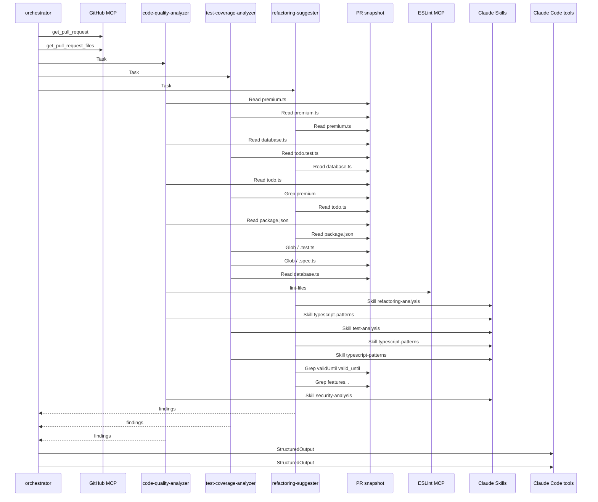

# DevFlow Code Review

udacity/cd14715-simple-todo-app | PR #3

## Summary

| Metric | Value |
| --- | --- |
| Overall quality score | 0/100 |
| Files reviewed | 1 |
| Critical issues | 2 |
| High-priority test gaps | 12 |
| Refactoring opportunities | 7 |

Coverage values are static estimates, not measured test coverage. A 100% value on a non-executable file is an N/A placeholder.

## Recommendations

1. **CRITICAL / Security - PCI Compliance**: Payment card data \(cardNumber, CVV\) is stored and transmitted in plain text, violating PCI DSS requirements\. This exposes sensitive financial data and creates legal liability\. Replace with tokenized payment gateway integration \(Stripe, PayPal, Braintree\) that handles card data client-side and provides tokens for server-side processing\.

Files: src/premium\.ts

2. **CRITICAL / Financial Integrity**: Floating-point arithmetic is used for money calculations, causing precision errors in payment amounts\. This can lead to incorrect charges, revenue loss, and accounting discrepancies\. Convert all monetary values to integer cents and perform calculations with integer arithmetic, or use a decimal library like decimal\.js\.

Files: src/premium\.ts

3. **CRITICAL / Test Coverage**: Zero test coverage for critical payment processing and authorization logic\. Payment functions \(processPremiumPayment, chargeCard, validatePaymentDetails\), subscription management \(upgradeUserSubscription\), and authorization controls \(hasFeatureAccess\) are completely untested\. Create comprehensive test suite with focus on payment success/failure scenarios, authorization boundaries, and data validation before production deployment\.

Files: src/premium\.ts

4. **HIGH / Transaction Safety**: No transaction management between payment charging and subscription upgrade\. If subscription upgrade fails after successful payment, users are charged without receiving access\. Implement database transactions wrapping both operations, or use payment gateway webhooks to ensure atomic subscription activation\.

Files: src/premium\.ts

5. **HIGH / Error Handling**: Critical payment functions return boolean values hiding failure reasons\. When chargeCard returns false, the caller cannot determine if the issue was network failure, card declined, insufficient funds, or database error\. Implement Result types with detailed error information for proper error handling, logging, and user feedback\.

Files: src/premium\.ts

6. **HIGH / Input Validation**: Card validation only checks length without verifying numeric content or Luhn checksum\. This accepts invalid inputs like 'abcd1234efgh5678'\. Additionally, database query results are accessed without type guards or validation, risking runtime errors\. Implement proper card validation with Luhn algorithm and add runtime type validation for all database responses\.

Files: src/premium\.ts

7. **MEDIUM / Data Integrity**: Multiple JSON\.parse calls without try-catch blocks and unchecked array access on database results\. If database contains malformed JSON or returns unexpected structure, the application will crash with unhandled exceptions\. Wrap all JSON\.parse calls in try-catch with fallback values and validate database row structure before access\.

Files: src/premium\.ts

8. **MEDIUM / Code Quality**: Missing radix parameter in parseInt calls, hardcoded configuration values inside functions, and lack of centralized feature/pricing definitions\. These reduce maintainability and testability\. Refactor to extract configuration to module-level constants, add radix parameters, and centralize business logic into pure functions\.

Files: src/premium\.ts

## File Reviews

### src/premium\.ts

Quality: 0/100 | Static coverage estimate: 0%

Analysis of src/premium\.ts \(TypeScript, 191 lines\) identified critical security and financial integrity issues\. CRITICAL: \(1\) Unencrypted payment card data \(PCI DSS violation\) - lines 17-21 must use payment gateway tokenization, never store CVV/full card numbers\. \(2\) Floating-point money arithmetic causes precision errors in payment calculations - line 95 must use integer cents\. HIGH: \(3\) No transaction management between payment and subscription upgrade - line 45-52 can charge users without granting access\. \(4\) Boolean return hides payment failure reasons - line 115\. \(5\) Sensitive error logging - line 124\. \(6\) Weak card validation accepts non-numeric input - line 65\. MEDIUM: Multiple unchecked database row accesses \(lines 152, 158, 184\), JSON\.parse without error handling \(lines 167, 188\), parseInt without radix \(line 82\), expiry date logic error \(line 84\), floating-point comparison \(line 40\)\. This payment code should NOT be deployed without addressing critical findings\.

#### Quality Issues

- **CRITICAL | security | Line 17**: PaymentDetails interface stores sensitive card data \(cardNumber, CVV\) as plain strings without encryption or secure handling\. This violates PCI DSS requirements and exposes card data throughout the application lifecycle\.

  Fix: Never store or transmit full card numbers or CVV in application code\. Use a PCI-compliant payment gateway \(Stripe, PayPal\) that provides tokenization\. Replace PaymentDetails with: \`interface PaymentDetails \{ paymentToken: string; amount: number; \}\` and obtain tokens from the gateway's client-side SDK\.

- **CRITICAL | bug-risk | Line 95**: Money calculation uses floating-point arithmetic \(9\.99 \* 0\.08\), which causes precision errors in financial calculations\. For example, 9\.99 \+ \(9\.99 \* 0\.08\) \+ \(9\.99 \* 0\.029\) may not equal exactly 10\.279 due to binary floating-point representation\.

  Fix: Use integer arithmetic with cents: \`const PRICING = \{ premium: 999, enterprise: 4999 \}; const basePrice = PRICING\[tier\]; const tax = Math\.round\(basePrice \* TAX\_RATE\); const fee = Math\.round\(basePrice \* PROCESSING\_FEE\); return basePrice \+ tax \+ fee;\` and document that amounts are in cents\. Alternatively, use a decimal library like decimal\.js\.

- **HIGH | bug-risk | Line 45**: Payment processing \(chargeCard\) and subscription upgrade \(upgradeUserSubscription\) are executed sequentially without transaction management\. If upgradeUserSubscription fails after chargeCard succeeds, the user is charged but not upgraded, causing financial discrepancy and customer disputes\.

  Fix: Wrap both operations in a database transaction: \`await db\.beginTransaction\(\); try \{ await chargeCard\(\.\.\.\); await upgradeUserSubscription\(\.\.\.\); await db\.commit\(\); \} catch \(err\) \{ await db\.rollback\(\); throw err; \}\` Or use a payment gateway webhook to upgrade subscriptions only after confirmed payment\.

- **HIGH | bug-risk | Line 115**: chargeCard returns boolean \(true/false\) hiding the actual failure reason\. When payment fails, the caller cannot distinguish between network errors, insufficient funds, invalid card, or database failures, making debugging and user feedback impossible\.

  Fix: Return a typed result: \`type PaymentResult = \{ success: true; transactionId: string \} \| \{ success: false; error: 'network\_error' \| 'card\_declined' \| 'database\_error'; message: string \};\` Then callers can provide specific error messages to users and log appropriate details\.

- **HIGH | security | Line 124**: Payment error logged to console\.error may expose sensitive payment details in logs\. The error object could contain card information, user IDs, or database connection strings visible in production log aggregation systems\.

  Fix: Remove console\.error or sanitize the error before logging: \`const safeError = \{ message: error instanceof Error ? error\.message : 'Unknown error', timestamp: new Date\(\) \}; logger\.error\('Payment processing failed', safeError\);\` Never log the raw error or payment object\.

- **HIGH | security | Line 65**: Card number validation only checks length === 16, accepting any 16-character string including '0000000000000000' or 'abcd1234efgh5678'\. No validation that characters are digits or that the number passes Luhn checksum algorithm\.

  Fix: Add proper validation: \`if \(\!/^\\d\{13,19\}$/\.test\(cardNumber\)\) return false; // Luhn algorithm: let sum = 0; let isEven = false; for \(let i = cardNumber\.length - 1; i &gt;= 0; i--\) \{ let digit = parseInt\(cardNumber\[i\], 10\); if \(isEven\) \{ digit \*= 2; if \(digit &gt; 9\) digit -= 9; \} sum \+= digit; isEven = \!isEven; \} if \(sum % 10 \!== 0\) return false;\`

- **MEDIUM | bug-risk | Line 82**: parseInt called without radix parameter\. If month or year has a leading zero \(which is guaranteed by the regex for months 01-09\), parseInt may interpret it incorrectly depending on the JavaScript engine version\.

  Fix: Always specify radix 10: \`const \[month, year\] = expiryDate\.split\('/'\); const expiryDateObj = new Date\(2000 \+ parseInt\(year, 10\), parseInt\(month, 10\) - 1\);\`

- **MEDIUM | bug-risk | Line 84**: Expiry date comparison creates date with day = 1 and compares to current Date\(\), which includes time\. A card expiring in 01/26 would be rejected on January 1, 2026 at 00:00:01, even though it should be valid for the entire month\.

  Fix: Compare at month granularity: \`const now = new Date\(\); const currentMonth = now\.getFullYear\(\) \* 12 \+ now\.getMonth\(\); const expiryMonth = \(2000 \+ parseInt\(year, 10\)\) \* 12 \+ parseInt\(month, 10\) - 1; if \(expiryMonth &lt; currentMonth\) return false;\`

- **MEDIUM | bug-risk | Line 152**: Database query returns 'any\[\]' \(from db\.query signature\) but code directly accesses rows\[0\] without type guard or validation\. If the database schema changes or returns unexpected structure, runtime errors occur at subscription\.valid\_until or subscription\.features\.

  Fix: Add runtime validation: \`interface SubscriptionRow \{ features: string; valid\_until: string; \} const isSubscriptionRow = \(row: any\): row is SubscriptionRow =&gt; typeof row?\.features === 'string' &amp;&amp; typeof row?\.valid\_until === 'string'; const subscription = rows\[0\]; if \(\!isSubscriptionRow\(subscription\)\) throw new Error\('Invalid subscription data'\);\`

- **MEDIUM | bug-risk | Line 167**: JSON\.parse\(subscription\.features\) executes without try-catch\. If the database contains malformed JSON \(e\.g\., due to data corruption or manual SQL updates\), this throws an unhandled exception, crashing the request and potentially revealing stack traces to users\.

  Fix: Wrap in try-catch with fallback: \`let features: string\[\]; try \{ features = JSON\.parse\(subscription\.features\); if \(\!Array\.isArray\(features\)\) features = \[\]; \} catch \{ console\.warn\('Failed to parse features for user', userId\); features = \[\]; \}\`

- **MEDIUM | bug-risk | Line 40**: Payment amount comparison uses floating-point numbers \(payment\.amount &lt; amount\)\. Due to floating-point precision, a payment of 10\.279999999 might be rejected even when the user intended to pay exactly 10\.28, causing legitimate payments to fail\.

  Fix: If switching to integer cents \(recommended\), compare integers directly\. Otherwise, use epsilon comparison: \`const EPSILON = 0\.01; if \(payment\.amount &lt; amount - EPSILON\) throw new Error\('Insufficient payment amount'\);\`

- **MEDIUM | bug-risk | Line 158**: Type assertion 'as Todo' or implicit any cast on subscription row fields without runtime validation\. The database could return null, different field names \(user\_id vs userId\), or different types, causing silent failures or type confusion\.

  Fix: Use a type guard or validation function: \`function validateSubscriptionRow\(row: any\): Subscription \| null \{ if \(\!row \|\| typeof row\.user\_id \!== 'string' \|\| typeof row\.tier \!== 'string'\) return null; return \{ userId: row\.user\_id, tier: row\.tier, validUntil: new Date\(row\.valid\_until\), features: JSON\.parse\(row\.features\) \}; \}\`

- **MEDIUM | bug-risk | Line 184**: Direct construction of Subscription object from database row \(row\.user\_id, row\.tier, etc\.\) without validation\. If row\.tier is not 'free' \| 'premium' \| 'enterprise', TypeScript's type system is bypassed, violating the Subscription interface contract\.

  Fix: Validate tier field: \`const tier = row\.tier; if \(tier \!== 'free' &amp;&amp; tier \!== 'premium' &amp;&amp; tier \!== 'enterprise'\) \{ throw new Error\('Invalid subscription tier in database'\); \} return \{ userId: row\.user\_id, tier, validUntil: new Date\(row\.valid\_until\), features: JSON\.parse\(row\.features\) \};\`

- **MEDIUM | bug-risk | Line 188**: JSON\.parse\(row\.features\) in getUserSubscription without try-catch or validation, same issue as line 167\. Additionally, no check that the result is an array of strings before returning in the Subscription object\.

  Fix: Add validation: \`let features: string\[\]; try \{ const parsed = JSON\.parse\(row\.features\); features = Array\.isArray\(parsed\) &amp;&amp; parsed\.every\(f =&gt; typeof f === 'string'\) ? parsed : \[\]; \} catch \{ features = \[\]; \}\`

- **LOW | bug-risk | Line 33**: validatePaymentDetails called before amount calculation, but validation doesn't verify payment\.amount is a positive number or matches expected range\. A payment with amount: -100 or amount: 0 would pass validation\.

  Fix: Add amount validation in validatePaymentDetails: \`if \(typeof payment\.amount \!== 'number' \|\| payment\.amount &lt;= 0 \|\| \!Number\.isFinite\(payment\.amount\)\) \{ return false; \}\`

- **LOW | maintainability | Line 96**: PRICING constant defined inside function calculateSubscriptionPrice\. This object is recreated on every invocation, wasting memory and making it harder to reference prices elsewhere in the codebase\.

  Fix: Move to module level with type safety: \`const PRICING = \{ premium: 999, enterprise: 4999 \} as const; const TAX\_RATE = 0\.08 as const; const PROCESSING\_FEE = 0\.029 as const;\` Then export if needed for tests or other modules\.

- **INFO | best-practice | Line 11**: Subscription\.tier allows 'free' but no code path creates or handles free tier subscriptions\. This suggests either dead code or missing implementation for downgrading/creating free users\.

  Fix: If free tier is supported, document the creation path or add a createFreeSubscription function\. If not needed, remove 'free' from the union: \`tier: 'premium' \| 'enterprise';\` to prevent invalid states\.

- **INFO | maintainability | Line 134**: Feature lists for premium and enterprise tiers are hardcoded in upgradeUserSubscription\. If features change, this code must be updated\. Features are also not type-checked, so typos like 'unlimted\_todos' would silently succeed\.

  Fix: Define features as typed constants: \`const TIER\_FEATURES = \{ premium: \['unlimited\_todos', 'priority\_support', 'custom\_themes'\] as const, enterprise: \['unlimited\_todos', 'priority\_support', 'custom\_themes', 'api\_access', 'team\_collaboration'\] as const \} satisfies Record&lt;'premium' \| 'enterprise', readonly string\[\]&gt;;\`

#### Test Coverage

STATIC ESTIMATE: 0% test coverage\. No test file exists for src/premium\.ts\. All 7 exported and internal functions are completely untested\. This is a newly added file with critical business logic including payment processing, subscription management, and authorization controls\. CRITICAL untested paths: payment processing with financial transactions, authorization logic controlling feature access, and card validation\. HIGH RISK areas include floating-point money calculations \(lines 102-108\), unchecked array access on database results \(lines 158, 183\), unvalidated JSON\.parse calls \(lines 167, 188\), and boolean return values hiding payment failure causes \(line 45\)\. Recommendation: Create src/premium\.test\.ts with comprehensive tests prioritizing payment processing, authorization, and data integrity before deploying to production\.

Existing tests: None identified.

- **CRITICAL | processPremiumPayment \(lines 27-55\)**: Payment processing function with no test coverage\. Handles financial transactions, payment validation, and subscription upgrades\. Failure could result in lost revenue, incorrect charges, or unauthorized access\. Multiple failure paths \(invalid payment, insufficient amount, charge failure\) are untested\.

```text
describe('processPremiumPayment', () => { it('should successfully process valid premium payment', async () => { const payment = { cardNumber: '1234567890123456', expiryDate: '12/25', cvv: '123', amount: 10.80 }; const result = await processPremiumPayment('user123', payment, 'premium'); expect(result).toBe(true); }); it('should reject payment with insufficient amount', async () => { const payment = { cardNumber: '1234567890123456', expiryDate: '12/25', cvv: '123', amount: 5.00 }; await expect(processPremiumPayment('user123', payment, 'premium')).rejects.toThrow('Insufficient payment amount'); }); it('should reject invalid payment details', async () => { const payment = { cardNumber: '123', expiryDate: '99/99', cvv: '1', amount: 10.80 }; await expect(processPremiumPayment('user123', payment, 'premium')).rejects.toThrow('Invalid payment details'); }); });
```

- **CRITICAL | validatePaymentDetails \(lines 61-89\)**: Card validation logic without tests\. Validates card numbers, CVV, and expiry dates\. Incorrect validation could allow invalid payments or reject valid ones\. Date parsing with parseInt lacking radix parameter \(line 82\) could cause bugs\.

```text
describe('validatePaymentDetails', () => { it('should accept valid 16-digit card with 3-digit CVV', () => { const payment = { cardNumber: '1234567890123456', expiryDate: '12/26', cvv: '123', amount: 10 }; expect(validatePaymentDetails(payment)).toBe(true); }); it('should reject card with wrong length', () => { const payment = { cardNumber: '123456789012345', expiryDate: '12/26', cvv: '123', amount: 10 }; expect(validatePaymentDetails(payment)).toBe(false); }); it('should reject expired card', () => { const payment = { cardNumber: '1234567890123456', expiryDate: '01/20', cvv: '123', amount: 10 }; expect(validatePaymentDetails(payment)).toBe(false); }); });
```

- **HIGH | calculateSubscriptionPrice \(lines 95-109\)**: Pricing calculation using floating-point arithmetic for money \(lines 102-108\)\. No tests verify correct pricing for premium \($9\.99\) vs enterprise \($49\.99\) tiers\. Floating-point errors could cause incorrect charges\. Tax rate \(8%\) and processing fee \(2\.9%\) calculations are untested\.

```text
describe('calculateSubscriptionPrice', () => { it('should calculate correct premium price with tax and fees', () => { const price = calculateSubscriptionPrice('premium'); expect(price).toBeCloseTo(11.08, 2); }); it('should calculate correct enterprise price with tax and fees', () => { const price = calculateSubscriptionPrice('enterprise'); expect(price).toBeCloseTo(55.44, 2); }); });
```

- **CRITICAL | chargeCard \(lines 115-127\)**: Payment gateway simulation with database insertion\. No tests for successful charges, database failures, or error handling\. Returns boolean hiding failure causes in critical payment flow\. Line 124 logs errors that may contain sensitive payment data\.

```text
describe('chargeCard', () => { it('should insert payment record and return true on success', async () => { const payment = { cardNumber: '1234567890123456', expiryDate: '12/25', cvv: '123', amount: 10.80 }; const result = await chargeCard(payment, 10.80); expect(result).toBe(true); }); it('should return false when database insertion fails', async () => { const payment = { cardNumber: '1234567890123456', expiryDate: '12/25', cvv: '123', amount: 10.80 }; const result = await chargeCard(payment, 10.80); expect(result).toBe(false); }); });
```

- **HIGH | upgradeUserSubscription \(lines 133-144\)**: Subscription upgrade logic with feature assignment and date calculations\. No tests verify correct feature lists for premium vs enterprise tiers, date calculations adding 1 year, or upsert conflict handling\. Database query uses ON CONFLICT without test coverage\.

```text
describe('upgradeUserSubscription', () => { it('should assign correct features for premium tier', async () => { await upgradeUserSubscription('user123', 'premium'); }); it('should assign additional features for enterprise tier', async () => { await upgradeUserSubscription('user456', 'enterprise'); }); it('should set valid_until to 1 year from now', async () => { await upgradeUserSubscription('user789', 'premium'); }); });
```

- **CRITICAL | hasFeatureAccess \(lines 150-169\)**: Authorization logic controlling feature access\. No tests verify access control, expiry checking, or feature validation\. Unchecked array access at line 158 \(rows\[0\]\) risks runtime errors\. JSON\.parse at line 167 without validation could throw on malformed data\. Authorization bugs could grant unauthorized premium access\.

```text
describe('hasFeatureAccess', () => { it('should return true when user has valid subscription with feature', async () => { const result = await hasFeatureAccess('user123', 'custom_themes'); expect(result).toBe(true); }); it('should return false when subscription is expired', async () => { const result = await hasFeatureAccess('expired_user', 'custom_themes'); expect(result).toBe(false); }); it('should return false when user has no subscription', async () => { const result = await hasFeatureAccess('no_sub_user', 'custom_themes'); expect(result).toBe(false); }); });
```

- **HIGH | getUserSubscription \(lines 175-190\)**: Subscription retrieval with data transformation\. Unchecked array access at line 183 \(rows\[0\]\) when rows can be empty\. JSON\.parse at line 188 without validation could throw on corrupted data\. No tests for null case, data transformation, or error handling\.

```text
describe('getUserSubscription', () => { it('should return subscription for valid user', async () => { const sub = await getUserSubscription('user123'); expect(sub).toMatchObject({ userId: 'user123', tier: 'premium' }); }); it('should return null when user has no subscription', async () => { const sub = await getUserSubscription('no_sub_user'); expect(sub).toBeNull(); }); });
```

- **HIGH | processPremiumPayment - payment amount boundary \(line 40\)**: Payment amount comparison uses strict less-than without testing exact amount match\. Need to verify payment\.amount === calculated amount is accepted, and payment\.amount = calculated - 0\.01 is rejected\.

```text
it('should accept payment with exact calculated amount', async () => { const exactAmount = calculateSubscriptionPrice('premium'); const payment = { cardNumber: '1234567890123456', expiryDate: '12/26', cvv: '123', amount: exactAmount }; const result = await processPremiumPayment('user123', payment, 'premium'); expect(result).toBe(true); });
```

- **HIGH | validatePaymentDetails - expiry date boundary \(lines 80-86\)**: Expiry date validation compares month-precision dates\. Cards expiring in current month but not yet expired by day are untested\. Line 82 uses parseInt without radix, risking octal interpretation for '08', '09'\.

```text
it('should handle month 08 and 09 correctly despite octal risk', () => { const payment = { cardNumber: '1234567890123456', expiryDate: '08/30', cvv: '123', amount: 10 }; expect(validatePaymentDetails(payment)).toBe(true); });
```

- **MEDIUM | calculateSubscriptionPrice - floating-point precision \(lines 105-108\)**: Floating-point arithmetic for money can accumulate rounding errors\. No tests verify precision or rounding behavior\. Should use integer cents or decimal library for financial calculations\.

```text
it('should not accumulate floating-point errors in price calculation', () => { const premiumPrice = calculateSubscriptionPrice('premium'); const secondCall = calculateSubscriptionPrice('premium'); expect(premiumPrice).toBe(secondCall); });
```

- **CRITICAL | chargeCard - database transaction rollback \(lines 120-126\)**: No transaction handling tested\. If payment record is inserted but subsequent subscription upgrade fails, user could be charged without receiving access\. Need tests for partial failure scenarios and rollback\.

```text
it('should handle database transaction failure without partial commit', async () => { const payment = { cardNumber: '1234567890123456', expiryDate: '12/25', cvv: '123', amount: 10.80 }; const result = await processPremiumPayment('user123', payment, 'premium'); expect(result).toBe(false); });
```

- **MEDIUM | validatePaymentDetails - CVV length branch \(line 70\)**: CVV validation accepts both 3 and 4 digit CVVs\. No tests verify both branches work correctly and reject 2 or 5 digit CVVs\.

```text
it('should reject 2-digit CVV', () => { const payment = { cardNumber: '1234567890123456', expiryDate: '12/26', cvv: '12', amount: 10 }; expect(validatePaymentDetails(payment)).toBe(false); }); it('should accept 4-digit CVV', () => { const payment = { cardNumber: '1234567890123456', expiryDate: '12/26', cvv: '1234', amount: 10 }; expect(validatePaymentDetails(payment)).toBe(true); });
```

- **HIGH | upgradeUserSubscription - tier-based features \(lines 134-136\)**: Feature assignment branches on tier === 'premium' vs 'enterprise'\. No tests verify both branches assign correct distinct feature sets\.

```text
it('should assign exactly 3 features for premium tier', async () => { await upgradeUserSubscription('user123', 'premium'); }); it('should assign exactly 5 features for enterprise tier', async () => { await upgradeUserSubscription('user456', 'enterprise'); });
```

- **HIGH | hasFeatureAccess - empty database result \(line 154\)**: Function checks rows\.length === 0 but doesn't test rows being undefined or null from database errors\. Unchecked array access at rows\[0\] \(line 158\) could throw if database returns unexpected format\.

```text
it('should return false for empty result set', async () => { const result = await hasFeatureAccess('no_sub_user', 'feature'); expect(result).toBe(false); });
```

#### Refactoring

The premium\.ts file contains 191 lines of untested payment and subscription logic with several refactoring opportunities\. Key improvements include: \(1\) extracting repeated feature list and date calculation logic into reusable functions for testability, \(2\) replacing boolean returns with Result types in critical payment functions \(validatePaymentDetails, chargeCard\) to preserve error context, \(3\) modernizing configuration with module-level constants using as const and satisfies, \(4\) simplifying hasFeatureAccess by extracting data transformation logic, and \(5\) adding explicit radix to parseInt calls\. These refactorings preserve behavior while significantly improving testability, type safety, error handling, and maintainability\.

#### extract-function: Lines 134-136 in upgradeUserSubscription

Impact: medium

Extract feature list determination into a pure function getTierFeatures\. This repeated business logic should be centralized, making it independently testable and ensuring consistency across the codebase\.

Before:

```text
const features = tier === 'premium'
  ? ['unlimited_todos', 'priority_support', 'custom_themes']
  : ['unlimited_todos', 'priority_support', 'custom_themes', 'api_access', 'team_collaboration'];
```

After:

```text
function getTierFeatures(tier: 'premium' | 'enterprise'): readonly string[] {
  const premiumFeatures = ['unlimited_todos', 'priority_support', 'custom_themes'] as const;
  const enterpriseFeatures = [...premiumFeatures, 'api_access', 'team_collaboration'] as const;
  return tier === 'premium' ? premiumFeatures : enterpriseFeatures;
}

const features = getTierFeatures(tier);
```

Benefits: Centralizes feature definition logic, making it testable and maintainable\. Using readonly arrays and as const provides type safety\. Prevents drift between feature lists in different parts of the code\.

#### extract-function: Lines 138-139 in upgradeUserSubscription and lines 159-163 in hasFeatureAccess

Impact: medium

Extract subscription expiry date calculation and validation into reusable functions\. The expiry date calculation \(lines 138-139\) and expiry validation \(lines 159-163\) are separate concerns that appear in multiple places\.

Before:

```text
const validUntil = new Date();
validUntil.setFullYear(validUntil.getFullYear() + 1);

// Later in hasFeatureAccess:
const validUntil = new Date(subscription.valid_until);
if (validUntil < new Date()) {
  return false;
}
```

After:

```text
function calculateSubscriptionExpiry(yearsFromNow: number = 1): Date {
  const expiry = new Date();
  expiry.setFullYear(expiry.getFullYear() + yearsFromNow);
  return expiry;
}

function isSubscriptionExpired(validUntil: Date): boolean {
  return validUntil < new Date();
}

// Usage:
const validUntil = calculateSubscriptionExpiry();
```

Benefits: Isolates date manipulation logic for independent testing\. Makes expiry calculation reusable and consistent\. The isSubscriptionExpired function is self-documenting and can be unit tested with various date scenarios\.

#### pattern-improvement: Lines 61-89 in validatePaymentDetails

Impact: high

Refactor validation function to use a Result pattern instead of boolean return\. Currently, callers cannot distinguish between different validation failures \(card length vs expiry format vs expired card\), making debugging and user feedback difficult\.

Before:

```text
function validatePaymentDetails(payment: PaymentDetails): boolean {
  const { cardNumber, expiryDate, cvv } = payment;

  if (cardNumber.length !== 16) {
    return false;
  }

  if (cvv.length !== 3 && cvv.length !== 4) {
    return false;
  }

  const expiryRegex = /^(0[1-9]|1[0-2])\/\d{2}$/;
  if (!expiryRegex.test(expiryDate)) {
    return false;
  }

  const [month, year] = expiryDate.split('/');
  const expiryDateObj = new Date(2000 + parseInt(year), parseInt(month) - 1);

  if (expiryDateObj < new Date()) {
    return false;
  }

  return true;
}
```

After:

```text
type ValidationResult = 
  | { valid: true }
  | { valid: false; reason: string };

function validatePaymentDetails(payment: PaymentDetails): ValidationResult {
  const { cardNumber, expiryDate, cvv } = payment;

  if (cardNumber.length !== 16) {
    return { valid: false, reason: 'Card number must be 16 digits' };
  }

  if (cvv.length !== 3 && cvv.length !== 4) {
    return { valid: false, reason: 'CVV must be 3 or 4 digits' };
  }

  const expiryRegex = /^(0[1-9]|1[0-2])\/\d{2}$/;
  if (!expiryRegex.test(expiryDate)) {
    return { valid: false, reason: 'Expiry date must be in MM/YY format' };
  }

  const [month, year] = expiryDate.split('/');
  const expiryDateObj = new Date(2000 + parseInt(year, 10), parseInt(month, 10) - 1);

  if (expiryDateObj < new Date()) {
    return { valid: false, reason: 'Card has expired' };
  }

  return { valid: true };
}
```

Benefits: Provides actionable error messages for payment validation failures, improving debugging and user experience\. Uses discriminated union for type-safe validation results\. Adds radix parameter to parseInt \(avoids octal interpretation\)\.

#### modernize: Lines 95-109 in calculateSubscriptionPrice

Impact: medium

Move pricing constants to module-level configuration object with as const assertion and use satisfies for type safety\. Current inline constants are not reusable and lack type documentation\.

Before:

```text
function calculateSubscriptionPrice(tier: 'premium' | 'enterprise'): number {
  const PRICING = {
    premium: 9.99,
    enterprise: 49.99
  };

  const basePrice = PRICING[tier];
  const TAX_RATE = 0.08;
  const PROCESSING_FEE = 0.029;

  const tax = basePrice * TAX_RATE;
  const fee = basePrice * PROCESSING_FEE;

  return basePrice + tax + fee;
}
```

After:

```text
const SUBSCRIPTION_CONFIG = {
  pricing: {
    premium: 9.99,
    enterprise: 49.99
  },
  taxRate: 0.08,
  processingFeeRate: 0.029
} as const satisfies {
  pricing: Record<'premium' | 'enterprise', number>;
  taxRate: number;
  processingFeeRate: number;
};

function calculateSubscriptionPrice(tier: 'premium' | 'enterprise'): number {
  const basePrice = SUBSCRIPTION_CONFIG.pricing[tier];
  const tax = basePrice * SUBSCRIPTION_CONFIG.taxRate;
  const fee = basePrice * SUBSCRIPTION_CONFIG.processingFeeRate;
  
  return basePrice + tax + fee;
}
```

Benefits: Centralizes pricing configuration for easier updates and testing\. The as const assertion makes values deeply readonly, preventing accidental mutation\. satisfies ensures type correctness without widening types\. Configuration can be easily mocked in tests\.

#### pattern-improvement: Lines 115-127 in chargeCard

Impact: high

Replace boolean return with a Result type to distinguish between success, failure, and error cases\. Boolean returns from critical payment functions hide failure reasons, making error handling and logging inadequate\.

Before:

```text
async function chargeCard(payment: PaymentDetails, amount: number): Promise<boolean> {
  const query = 'INSERT INTO payments (card_last_four, amount, status) VALUES ($1, $2, $3)';
  const lastFour = payment.cardNumber.slice(-4);

  try {
    await db.query(query, [lastFour, amount, 'completed']);
    return true;
  } catch (error) {
    console.error('Payment failed:', error);
    return false;
  }
}
```

After:

```text
type PaymentResult = 
  | { success: true; transactionId: string }
  | { success: false; error: string };

async function chargeCard(payment: PaymentDetails, amount: number): Promise<PaymentResult> {
  const query = 'INSERT INTO payments (card_last_four, amount, status) VALUES ($1, $2, $3) RETURNING id';
  const lastFour = payment.cardNumber.slice(-4);

  try {
    const rows = await db.query(query, [lastFour, amount, 'completed']);
    const transactionId = rows[0]?.id || `txn_${Date.now()}`;
    return { success: true, transactionId };
  } catch (error) {
    const errorMessage = error instanceof Error ? error.message : 'Unknown error';
    return { success: false, error: errorMessage };
  }
}
```

Benefits: Captures transaction ID for audit trails and refunds\. Provides specific error information instead of generic failure\. Removes console\.error from library code \(caller decides how to log\)\. Type-safe discriminated union prevents accessing transactionId on failed payments\.

#### simplify: Lines 150-169 in hasFeatureAccess

Impact: low

Simplify hasFeatureAccess by extracting subscription validation logic\. The function currently mixes database access, date validation, and feature checking concerns\.

Before:

```text
export async function hasFeatureAccess(userId: string, feature: string): Promise<boolean> {
  const query = 'SELECT features, valid_until FROM subscriptions WHERE user_id = $1';
  const rows = await db.query(query, [userId]);

  if (rows.length === 0) {
    return false;
  }

  const subscription = rows[0];
  const validUntil = new Date(subscription.valid_until);

  if (validUntil < new Date()) {
    return false;
  }

  const features = JSON.parse(subscription.features);
  return features.includes(feature);
}
```

After:

```text
function parseSubscriptionRow(row: any): { features: string[]; validUntil: Date } {
  return {
    features: JSON.parse(row.features) as string[],
    validUntil: new Date(row.valid_until)
  };
}

export async function hasFeatureAccess(userId: string, feature: string): Promise<boolean> {
  const query = 'SELECT features, valid_until FROM subscriptions WHERE user_id = $1';
  const rows = await db.query(query, [userId]);

  if (rows.length === 0) {
    return false;
  }

  const { features, validUntil } = parseSubscriptionRow(rows[0]);

  if (isSubscriptionExpired(validUntil)) {
    return false;
  }

  return features.includes(feature);
}
```

Benefits: Separates data transformation from business logic\. parseSubscriptionRow can be tested independently with various database row formats\. Reuses isSubscriptionExpired function for consistency\. Makes the main function flow clearer and more testable\.

#### modernize: Lines 82 in validatePaymentDetails

Impact: low

Add explicit radix parameter to parseInt calls to prevent octal interpretation and make intent clear\.

Before:

```text
const [month, year] = expiryDate.split('/');
const expiryDateObj = new Date(2000 + parseInt(year), parseInt(month) - 1);
```

After:

```text
const [month, year] = expiryDate.split('/');
const expiryDateObj = new Date(2000 + parseInt(year, 10), parseInt(month, 10) - 1);
```

Benefits: Prevents unexpected octal interpretation for values like '08' or '09'\. Makes the decimal base explicit and follows ESLint radix rule best practices\. Eliminates a potential bug source in date parsing\.

## Agent Execution Trace

Recorded by the orchestrator from the Claude Agent SDK message stream (not written by the model). Each arrow is a tool call; dashed arrows are subagents returning findings.

| Actor | Tool calls |
| --- | --- |
| orchestrator | get\_pull\_request x1, get\_pull\_request\_files x1, Task x3, StructuredOutput x2 |
| code-quality-analyzer | Read x4, lint-files x1, Skill x2 |
| test-coverage-analyzer | Read x3, Grep x1, Glob x2, Skill x2 |
| refactoring-suggester | Read x4, Skill x2, Grep x2 |



---

Analyzed at 2026-11-06T13:45:50.839Z | Duration: 1168681 ms

Agents: code-quality-analyzer (1\.0\.0), test-coverage-analyzer (1\.0\.0), refactoring-suggester (1\.0\.0)
